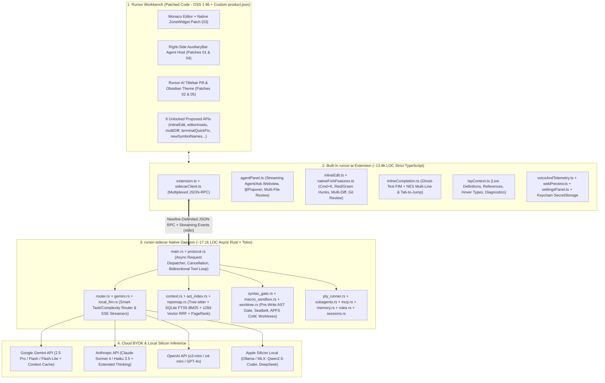
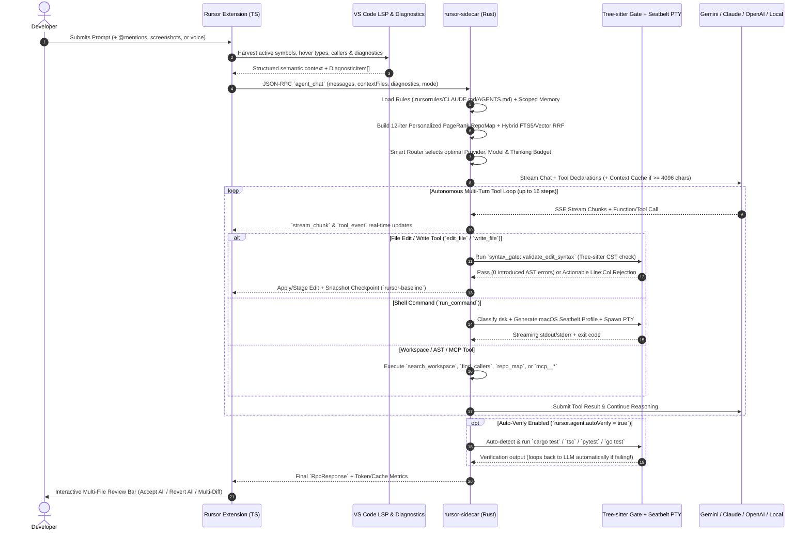
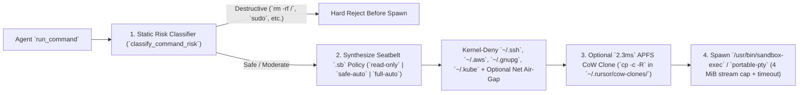

<div align="center">


# R U R S O R

### The Open-Source, Rust-Powered AI-Native Code Editor & Autonomous Agent Runtime

**Built in the open to compete head-to-head with Cursor, Google Antigravity, OpenAI Codex, and Claude Code.**

[](#license)
[](sidecar/)
[](fork/)
[](sidecar/src/router.rs)
[](sidecar/src/macos_sandbox.rs)
[](#-we-want-you--join-the-movement--contribute)

<p align="center">
  <a href="#-the-open-source-manifesto-why-rursor-exists"><b>Manifesto</b></a> •
  <a href="#-head-to-head-rursor-vs-cursor-vs-antigravity-vs-codex-vs-claude-code"><b>vs. The Giants</b></a> •
  <a href="#-system-architecture-deep-dive"><b>Architecture</b></a> •
  <a href="#-complete-feature-tour"><b>Features</b></a> •
  <a href="#-quick-start-up-and-running-in-15-seconds"><b>Quick Start</b></a> •
  <a href="#-cli--json-rpc-wire-protocol"><b>CLI & Protocol</b></a> •
  <a href="#-benchmarks--deterministic-eval-harness-rursor-eval"><b>Benchmarks</b></a> •
  <a href="#-we-want-you--join-the-movement--contribute"><b>Contribute!</b></a>
</p>

> **Watch the Demo:** Check out [`rursor-intro.mp4`](rursor-intro.mp4) right in the repository root to see Rursor in action.

</div>

---

## 🔥 The Open-Source Manifesto: Why Rursor Exists

Software engineering is undergoing the biggest paradigm shift in fifty years. The editor is no longer a passive text buffer—it is an **autonomous, codebase-aware reasoning environment** where inline diffs, next-edit cursor predictions, background subagent swarms, kernel-sandboxed terminals, and multi-file architecture graphs work together at the speed of thought.

Right now, that future is being locked behind closed doors:

- **Cursor** proved how magical deeply integrated Tab/NES prediction and `Cmd+K` / `Cmd+L` workflows feel—but its core editor patches, prompt engines, context rankers, and routing layers are closed-source, tied to opaque credit tiers and cloud-hosted indexing pipelines.
- **Google Antigravity** pushed the frontier of multi-agent orchestration, browser verification, and deep Gemini reasoning—inside a proprietary distribution.
- **OpenAI Codex** pioneered kernel-sandboxed (`Seatbelt`) parallel worktree execution and autonomous verification loops—locked to a single ecosystem.
- **Claude Code** showed the raw power of an unthrottled terminal agent with `CLAUDE.md` project memory, PTY control, and surgical tool-calling—without a native graphical multi-diff IDE, inline `Cmd+K` ZoneWidget, or sub-50ms ghost-text Tab engine.

**We believe the most important tool developers use for 8+ hours every day must belong to developers.**

**Rursor** (`Rust` + `Cursor`) is our answer: a **32,400+ line**, clean-room, open-source AI-native IDE, terminal CLI, and local Rust agent engine that combines the **best ideas from Cursor, Antigravity, Codex, and Claude Code into one hackable, local-first, zero-markup platform**:

1. **Zero Black Boxes, 100% Inspectable Prompts & Ranking:** Every system prompt, Tree-sitter AST chunker, SQLite FTS5 + 128-dim vector Reciprocal Rank Fusion scorer, 12-iteration Personalized PageRank RepoMap, and Next-Edit Suggestion (`NES`) parser lives in clean, unit-tested Rust under [`sidecar/src/`](sidecar/src/).
2. **True BYOK + Zero-Cost Local Silicon:** Bring your own **Gemini**, **Anthropic Claude**, or **OpenAI (`gpt-4o` / `o3` / `o4-mini`)** keys stored directly in your macOS Keychain—paying exact upstream API cost with **$0 middleman markup**—or route Tab autocomplete to **local `Ollama` / Apple Silicon `MLX`** (`qwen2.5-coder`, `deepseek-coder`) for 100% offline, zero-latency inference.
3. **100% Local Codebase Indexing (Your Code Never Leaves Your Disk):** Unlike cloud IDEs that upload Merkle trees and source chunks to remote vector databases, Rursor indexes your codebase locally in milliseconds using embedded Rust `tree-sitter` grammars + bundled `rusqlite` FTS5.
4. **Native Fork Power Without Fork Bloat:** Instead of maintaining a 10-million-line diverged fork that rots behind upstream VS Code, [`fork/`](fork/) applies **5 surgical, idempotent patches** + a custom `product.json` over upstream `Code - OSS`—unlocking 9 internal VS Code Proposed APIs (`inlineEdit`, `editorInsets`, `tabInputMultiDiff`, `terminalQuickFixProvider`, `newSymbolNamesProvider`, and more) while keeping a 10-second daily dev loop.
5. **Built for Contributors to Own & Dominate:** We are building Rursor in public and **we want engineers, researchers, compiler nerds, UI designers, and AI hackers everywhere to jump in and make this the undisputed #1 AI coding tool in the world.** Whether you want to port the sandbox to Linux/Windows, tune SWE-bench pass rates, build speculative decoding for Tab, or craft killer Monaco UI widgets—**the keys to the kingdom are right here.**

---

## 📑 Table of Contents

1. [Head-to-Head: Rursor vs. Cursor vs. Antigravity vs. Codex vs. Claude Code](#-head-to-head-rursor-vs-cursor-vs-antigravity-vs-codex-vs-claude-code)
   - [How Rursor Takes On Cursor](#1-how-rursor-takes-on-cursor)
   - [How Rursor Takes On Google Antigravity](#2-how-rursor-takes-on-google-antigravity)
   - [How Rursor Takes On OpenAI Codex](#3-how-rursor-takes-on-openai-codex)
   - [How Rursor Takes On Claude Code](#4-how-rursor-takes-on-claude-code)
2. [Codebase at a Glance (32,400+ Lines of Rust & TypeScript)](#-codebase-at-a-glance-32400-lines-of-rust--typescript)
3. [System Architecture Deep-Dive](#-system-architecture-deep-dive)
   - [Three-Tier Native Stack](#three-tier-native-stack)
   - [End-to-End Agent Turn Lifecycle](#end-to-end-agent-turn-lifecycle)
   - [Complete Repository Directory & File Map](#complete-repository-directory--file-map)
4. [Complete Feature Tour](#-complete-feature-tour)
   - [1. Autonomous Multi-Turn Agent & Ask Sidebar (`Cmd+L`)](#1-autonomous-multi-turn-agent--ask-sidebar-cmdl)
   - [2. `Cmd+K` Inline Edit, Floating Monaco ZoneWidget & Red/Green Hunk Diffs](#2-cmdk-inline-edit-floating-monaco-zonewidget--redgreen-hunk-diffs)
   - [3. Hybrid Tab Autocomplete, Next-Edit Prediction (`NES`) & Cross-File Tab-to-Jump](#3-hybrid-tab-autocomplete-next-edit-prediction-nes--cross-file-tab-to-jump)
   - [4. Local-First Codebase Intelligence: Tree-Sitter AST + SQLite FTS5 + Vector RRF + PageRank RepoMap](#4-local-first-codebase-intelligence-tree-sitter-ast--sqlite-fts5--vector-rrf--pagerank-repomap)
   - [5. Deep LSP Semantic Context Bridge](#5-deep-lsp-semantic-context-bridge)
   - [6. Smart Multi-Provider Model Router (`Gemini` + `Claude` + `OpenAI` + `Local LLM`)](#6-smart-multi-provider-model-router-gemini--claude--openai--local-llm)
   - [7. OS-Level Security & Instant Sandboxes: macOS Seatbelt + APFS Copy-on-Write (`clonefile`) + Git Worktrees](#7-os-level-security--instant-sandboxes-macos-seatbelt--apfs-copy-on-write-clonefile--git-worktrees)
   - [8. Tree-Sitter Pre-Write Syntax Gate & Auto-Verify Self-Healing Loops](#8-tree-sitter-pre-write-syntax-gate--auto-verify-self-healing-loops)
   - [9. Parallel Subagent Swarms (`JoinSet`)](#9-parallel-subagent-swarms-joinset)
   - [10. Real PTY Runner, Terminal Quick-Fix, Debugger Explainer & AI Git Diff Code Review](#10-real-pty-runner-terminal-quick-fix-debugger-explainer--ai-git-diff-code-review)
   - [11. Built-In Live Web Preview & DOM/Error Inspector](#11-built-in-live-web-preview--domerror-inspector)
   - [12. Voice-to-Code (`Cmd+Shift+V`) & Real-Time Latency / Cache / Cost Telemetry](#12-voice-to-code-cmdshiftv--real-time-latency--cache--cost-telemetry)
   - [13. Universal Rules Compatibility (`.cursorrules`, `CLAUDE.md`, `AGENTS.md`), Memory, Skills & MCP](#13-universal-rules-compatibility-cursorrules-claudemd-agentsmd-memory-skills--mcp)
   - [14. Native `Code - OSS` Fork Patches & Rursor Obsidian Theme](#14-native-code---oss-fork-patches--rursor-obsidian-theme)
5. [Algorithmic Internals & Local Disk Schema](#-algorithmic-internals--local-disk-schema)
6. [Quick Start (Up and Running in 15 Seconds)](#-quick-start-up-and-running-in-15-seconds)
   - [Prerequisites](#prerequisites)
   - [Workflow A: Instant Extension Dev Host (`10–15 seconds`)](#workflow-a-instant-extension-dev-host-1015-seconds)
   - [Workflow B: Patched Rursor Workbench Dev Loop](#workflow-b-patched-rursor-workbench-dev-loop)
   - [Workflow C: Full Standalone `Rursor.app` & `Rursor-arm64.dmg` Release Build](#workflow-c-full-standalone-rursorapp--rursor-arm64dmg-release-build)
7. [Keyboard Shortcuts, Commands & Settings Reference](#-keyboard-shortcuts-commands--settings-reference)
   - [Default Keybindings](#default-keybindings)
   - [All 30 Command Palette Actions](#all-30-command-palette-actions)
   - [Complete Configuration Properties (`settings.json`)](#complete-configuration-properties-settingsjson)
8. [CLI & JSON-RPC Wire Protocol](#-cli--json-rpc-wire-protocol)
   - [The `rursor` Command-Line Interface](#the-rursor-command-line-interface)
   - [`rursor-sidecar` Newline-Delimited JSON-RPC Protocol](#rursor-sidecar-newline-delimited-json-rpc-protocol)
   - [Built-In Autonomous Agent Tools](#built-in-autonomous-agent-tools)
   - [Configuration Recipes (MCP, Rules, Local Apple Silicon Autocomplete)](#configuration-recipes-mcp-rules-local-apple-silicon-autocomplete)
9. [Benchmarks & Deterministic Eval Harness (`rursor-eval`)](#-benchmarks--deterministic-eval-harness-rursor-eval)
   - [Measured Apple Silicon (`Darwin-arm64`) Benchmark Results](#measured-apple-silicon-darwin-arm64-benchmark-results)
10. [WE WANT YOU! — Join the Movement & Contribute](#-we-want-you--join-the-movement--contribute)
    - [Why Contribute to Rursor?](#why-contribute-to-rursor)
    - [Contributor Quest Board (Beginner -> Intermediate -> Systems Master)](#contributor-quest-board-beginner---intermediate---systems-master)
    - [High-Impact Roadmap & Open Contributor Quests](#high-impact-roadmap--open-contributor-quests)
    - [5 Copy-Paste Contributor Playbooks (Extend Rursor in Minutes)](#5-copy-paste-contributor-playbooks-extend-rursor-in-minutes)
    - [How to Make Your First Contribution in 5 Minutes](#how-to-make-your-first-contribution-in-5-minutes)
    - [Engineering Standards & Design Principles](#engineering-standards--design-principles)
11. [Security, Privacy & Local-First Guarantees](#-security-privacy--local-first-guarantees)
12. [Troubleshooting & FAQ](#-troubleshooting--faq)
13. [License & Acknowledgments](#-license--acknowledgments)

---

## ⚔️ Head-to-Head: Rursor vs. Cursor vs. Antigravity vs. Codex vs. Claude Code

Why choose between a slick GUI editor, a kernel-sandboxed worktree runner, a parallel multi-agent orchestrator, and a lightning-fast local terminal workflow when one open-source stack can unite them all?

| Capability / Dimension | **Rursor (Open Source)** | **Cursor** | **Google Antigravity** | **OpenAI Codex** | **Claude Code** |
| :--- | :--- | :--- | :--- | :--- | :--- |
| **Source License** | **100% Open Source (MIT)** | Proprietary / Closed | Proprietary / Closed | CLI Open / App Proprietary | Proprietary / Closed |
| **Pricing & API Economics** | **$0 Markup BYOK + $0 Local Models** | Subscription + Usage Markup | Subscription / Quota Tiers | Subscription / API Credits | Subscription / API Credits |
| **Multi-Model Freedom** | **Gemini + Claude + OpenAI + Ollama + MLX** | Multi-model (Cloud Proxy) | Primarily Gemini / Cloud | OpenAI Only | Anthropic Claude Only |
| **Core Engine Runtime** | **Native Async Rust (`rursor-sidecar`)** | Electron / Node + Cloud | Proprietary Daemon + Cloud | Rust CLI / Cloud Containers | Node.js / Bun CLI |
| **Native GUI Workbench** | **Yes (`Code - OSS` Fork + 9 Proposed APIs)** | Yes (VS Code Fork) | Yes (VS Code Fork) | Desktop Wrapper / CLI | Terminal CLI (+ IDE Plugin) |
| **Tab Ghost-Text + Offline Local Silicon** | **Yes (Gemini Flash-Lite + Local Ollama/MLX)** | Cloud Only (Cursor Tab) | Cloud Only | No Native Editor Tab | No Native Editor Tab |
| **Next-Edit Suggestion (`NES`) + Tab-to-Jump** | **Yes (`nes.rs` Cross-File + Line Jump)** | Yes (Cursor Tab) | Yes | No | No |
| **`Cmd+K` Inline Monaco ZoneWidget + Diffs** | **Yes (Native Patch + Editor Insets + Hunks)** | Yes | Yes | No | No |
| **100% Local Codebase Indexing** | **Yes (Tree-sitter + SQLite FTS5 + 128d RRF)** | Uploads to Remote Cloud Index | Workspace Local / Cloud | Grep / File Read | Grep / File Read |
| **Personalized PageRank RepoMap** | **Yes (12-Iter PPR over AST Import Graph)** | Proprietary Context Engine | Proprietary Context Engine | No | No |
| **Pre-Write AST Syntax Gate** | **Yes (`syntax_gate.rs` Blocks Broken Edits)** | Post-Edit Lint Loop | Post-Edit Lint Loop | Post-Edit Test Loop | Post-Edit Lint/Test |
| **Kernel-Level OS Command Sandbox** | **Yes (macOS Seatbelt `sandbox-exec` Profiles)** | Optional / Terminal Approval | Yes (Seatbelt Sandboxed) | Yes (Seatbelt / Landlock) | Permission Prompts / Sandbox |
| **Instant APFS Copy-on-Write (`clonefile`) Clones** | **Yes (`cp -c -R` Millisecond Repo Clones)** | No (Git Worktrees Only) | Git Worktrees | Git Worktrees / Cloud VM | Git Worktrees |
| **Parallel Subagent Swarms** | **Yes (`tokio::task::JoinSet` Fan-Out)** | Background Agents (Cloud) | Yes (Subagents & Workflows) | Parallel Cloud Tasks | Subagent Tool |
| **Built-In Live Web Preview + DOM Inspector** | **Yes (`webPreview.ts` Desktop/Mobile + Logs)** | External / Simple Browser | Yes (Browser Agent) | No | No |
| **Voice Prompting (`Cmd+Shift+V`)** | **Yes (Native Audio Capture -> Multimodal)** | OS Dictation Only | OS Dictation | Voice in App | `/voice` Mode |
| **Live TTFT, Cache Savings & USD Cost HUD** | **Yes (`p50`/`p95` TTFT, Tok/s, Exact $ HUD)** | Opaque Credit Meter | Quota Meter | Token Counter | `/cost` Command |
| **Universal Rules Compatibility** | **Reads `.rursorrules`, `.cursorrules`, `AGENTS.md`, `CLAUDE.md`** | `.cursorrules` / `.cursor/rules` | `AGENTS.md` / Rules | `AGENTS.md` | `CLAUDE.md` |
| **Model Context Protocol (MCP)** | **Yes (Native Rust Async Stdio Client)** | Yes | Yes | Yes | Yes |
| **Self-Hosted Deterministic Eval Suite** | **Yes (`rursor-eval` Latency, Recall@5, Pass@1)** | Internal Only | Internal Only | Public Benchmarks | Internal Only |

### 1. How Rursor Takes On **Cursor**
Cursor defined the modern AI editor UX (`Cmd+K`, `Cmd+L`, `@`-mentions, `.cursorrules`, and `Cursor Tab`). However, Cursor requires routing every prompt and codebase index through closed proprietary servers, charges usage markups on top of model costs, and keeps its fork patches and NES ranking logic closed.
- **Where Rursor Matches & Goes Further:** Rursor brings native `Cmd+K` Monaco ZoneWidget inline editing, `Cmd+L` multi-file Composer/Agent review (`Alt+Cmd+D` Multi-Diff), `.cursorrules` auto-loading, and cross-file **Next-Edit Prediction (`nes.rs`) + Tab-to-Jump** into **100% MIT open source**—while keeping your entire AST/vector index **100% local on your machine**, supporting **offline Apple Silicon `Ollama`/`MLX` Tab completions**, and enforcing **macOS Seatbelt + APFS Copy-on-Write kernel sandboxes** that Cursor lacks locally.

### 2. How Rursor Takes On **Google Antigravity**
Google Antigravity pioneered deep Gemini 2.5 reasoning budgets, parallel subagent fan-out, live Web/Browser preview inspection, custom skills, and OS-sandboxed terminal execution inside an AI-first workbench.
- **Where Rursor Matches & Goes Further:** Rursor natively integrates **Gemini 2.5 Pro / Flash / Flash-Lite** with dynamic **Thinking Budgets (`8,192–16,384` tokens)**, **Gemini Context Caching**, **`tokio::task::JoinSet` parallel subagent swarms**, a built-in **Desktop/Mobile Web Preview + DOM/Script Error Inspector (`webPreview.ts`)**, and `.rursor/skills/*.md`—while freeing you from single-vendor lock-in! Switch to **Claude Sonnet 4**, **OpenAI `o3-mini`**, or **local Qwen 2.5 Coder** on any turn, and audit every line of Rust & TypeScript yourself.

### 3. How Rursor Takes On **OpenAI Codex**
OpenAI Codex (App & CLI) proved the value of kernel-enforced `Seatbelt` sandboxing, `AGENTS.md` repository instructions, and running isolated tasks in parallel worktrees with automated test verification.
- **Where Rursor Matches & Goes Further:** Rursor natively reads `AGENTS.md`, enforces **macOS Seatbelt (`sandbox-exec`)** profiles with automatic destructive-command blocking, manages **Git Worktrees**, and **leaps ahead on macOS** with **`2.3ms` APFS Copy-on-Write (`cp -c -R` / `clonefile`) workspace clones**—cloning untracked files, `target/`, and `node_modules/` instantaneously without re-installing dependencies or spinning up slow cloud containers, all paired with a full native Monaco IDE!

### 4. How Rursor Takes On **Claude Code**
Anthropic's Claude Code set the gold standard for agentic terminal ergonomics: real PTY command control, `CLAUDE.md` memory, background process management, `/cost` transparency, voice mode, and relentless multi-step tool execution.
- **Where Rursor Matches & Goes Further:** Rursor loads `CLAUDE.md` natively, streams **Anthropic `/v1/messages` with Extended Thinking**, runs a real **`portable-pty` pseudo-terminal** + background process manager in Rust, includes **`Cmd+Shift+V` Voice-to-Code**, and exposes a live **`p50`/`p95` TTFT + Cache Savings + USD Cost Telemetry HUD**—while adding everything a pure terminal CLI cannot do: **sub-100ms ghost-text Tab/NES**, **`Cmd+K` inline hunk diffs**, **LSP hover/reference harvesting**, **inline Git Diff review threads**, and a **`0.07ms` pre-write Tree-sitter Syntax Gate** that stops broken edits before they ever hit disk!

---

## 📊 Codebase at a Glance (32,400+ Lines of Rust & TypeScript)

Rursor is not a weekend toy wrapper or a thin prompt template—it is a deeply engineered, production-structured systems & IDE codebase with **zero `any` types** in TypeScript and comprehensive unit tests across its Rust subsystems:

| Subsystem | Location | Language & Stack | Lines of Code | Core Responsibility |
| :--- | :--- | :--- | ---: | :--- |
| **Rust AI Sidecar** | [`sidecar/src/`](sidecar/src/) | Rust 2021 (`tokio`, `reqwest`, `rusqlite`, `tree-sitter`, `portable-pty`) | **~17,070 LOC** | Async JSON-RPC daemon, hybrid AST/FTS5/vector index, PageRank RepoMap, LLM router, NES engine, Seatbelt & APFS CoW sandboxes, PTY, MCP, memory, syntax gate, subagents |
| **Built-In IDE Extension** | [`extension/src/`](extension/src/) | TypeScript 5.6 (`strict: true`, VS Code + 9 Proposed APIs) | **~13,784 LOC** | Agent/Ask Webview UI, `Cmd+K` inline hunk diffs, native Monaco bridges, Tab/NES provider, LSP semantic harvester, Multi-Diff, Voice, Telemetry, Web Preview, Settings UI |
| **Eval & Benchmark Suite** | [`eval/`](eval/) | Python 3 + JSON Task Specs | **~742 LOC** | Deterministic cold/warm RPC latency, indexing throughput, Recall@5, precision, syntax gate, Seatbelt, APFS CoW, and live Pass@1 harness |
| **CLI & Build Tooling** | [`scripts/`](scripts/), [`fork/scripts/`](fork/scripts/) | Bash + Python | **~820 LOC** | `rursor` global CLI, 10-second dev-host launcher, patched workbench runner, `arm64` Electron builder, code signer, `.dmg` packager |
| **Workbench Fork Overlay** | [`fork/patches/`](fork/patches/), [`fork/product.json`](fork/product.json) | TypeScript / CSS Git Patches + JSON | **5 Patches + Branding** | Default right-hand Agent AuxiliaryBar, titlebar AI pill, native Monaco inline ZoneWidget, hidden stock chat clutter, default Rursor Obsidian dark theme |
| **Total Custom Engineering** | **Repository Root** | **Rust + TS + Python + Shell + Patches** | **32,416+ LOC** | **End-to-end open-source AI-native coding platform** |

---

## 🏗️ System Architecture Deep-Dive

### Three-Tier Native Stack

Rursor intentionally decouples **UI rendering & editor integration** (TypeScript inside the Electron Extension Host / Monaco Workbench) from **CPU-intensive indexing, AST parsing, sandboxing, PTY management, and LLM streaming** (a native compiled `arm64` Rust binary, `rursor-sidecar`).

Because `rursor-sidecar` runs out-of-process over a persistent, multiplexed newline-delimited JSON-RPC pipe (`stdin`/`stdout`), **your editor UI never freezes**—even while indexing thousands of files with Tree-sitter, computing 12 iterations of Personalized PageRank, cloning gigabyte workspaces via APFS Copy-on-Write, or streaming parallel subagent completions.



### End-to-End Agent Turn Lifecycle

Here is what happens under the hood in milliseconds when you press `Cmd+L` and ask Rursor Agent to implement a multi-file feature or squash a tricky concurrency bug:



### Complete Repository Directory & File Map

Every file in the repository has a clear, single-purpose home—making it effortless for new contributors to navigate and hack on:

```text
rursor/
├── README.md                                  # You are here!
├── rursor-intro.mp4                           # Product walkthrough & live demo video
│
├── sidecar/                                   # Native Async Rust AI Daemon (~17,070 LOC)
│   ├── Cargo.toml                             # tokio, reqwest (rustls), rusqlite (bundled), portable-pty, tree-sitter (5 langs)
│   └── src/
│       ├── main.rs                (2,571 LOC) # Async stdio JSON-RPC server, request multiplexer, 16-step agent loop, tool dispatch
│       ├── macos_sandbox.rs       (2,942 LOC) # Command risk classifier, Seatbelt (.sb) generator, APFS CoW (`cp -c -R`) clone manager
│       ├── ast_index.rs           (2,052 LOC) # Tree-sitter AST chunker, SQLite FTS5 BM25 + 128-dim cosine embedding RRF hybrid search
│       ├── repomap.rs             (1,794 LOC) # Dependency graph builder + 12-iteration Personalized PageRank token-budgeted RepoMap
│       ├── context.rs             (1,064 LOC) # .gitignore-aware walker, mtime incremental sync, grep, symbol search, git context
│       ├── router.rs                (941 LOC) # Multi-provider TaskKind/complexity router + Anthropic & OpenAI streaming SSE clients
│       ├── worktree.rs              (918 LOC) # Isolated Git worktree creation/diff/merge + file-level CheckpointStore
│       ├── nes.rs                   (746 LOC) # Next-Edit Suggestion (edit/insert/jump) prompt builder, JSON parser & caller site finder
│       ├── memory.rs                (696 LOC) # Workspace (.rursor/memory.json) & Global persistent memory + custom Markdown skills
│       ├── syntax_gate.rs           (669 LOC) # Pre-write Tree-sitter CST & JSON syntax error validator (Rust, TS, TSX, JS, Python, Go)
│       ├── gemini.rs                (642 LOC) # Native Gemini Cloud API streaming client, function calling, thinking budgets, context caching
│       ├── pty_runner.rs            (492 LOC) # Real pseudo-terminal execution (`portable-pty`) & background daemon process manager
│       ├── protocol.rs              (415 LOC) # Strongly-typed Serde wire structs for all RPC requests, responses, and streaming events
│       ├── subagents.rs             (406 LOC) # Parallel read-only subagent swarm runner (`JoinSet`) + auto-verify test detector
│       ├── mcp.rs                   (356 LOC) # Async stdio Model Context Protocol (MCP) client, tool discovery & invocation
│       ├── sessions.rs              (180 LOC) # Persistent chat session storage (`~/.rursor/sessions/`)
│       ├── local_llm.rs             (102 LOC) # Local Ollama & Apple Silicon MLX HTTP completion client for offline Tab autocomplete
│       └── rules.rs                  (84 LOC) # Loader for `.rursorrules`, `.cursorrules`, `AGENTS.md`, `CLAUDE.md`, `.rursor/rules/*.md`
│
├── extension/                                 # Built-In VS Code / Rursor Extension (~13,784 LOC, strict TS, zero `any`)
│   ├── package.json                           # Manifest: 30 commands, keybindings, AuxiliaryBar view, Rursor Obsidian theme, settings
│   ├── tsconfig.json                          # Strict TypeScript compiler configuration
│   ├── themes/
│   │   └── rursor-obsidian-dark.json          # High-contrast, deep-obsidian AI-native dark color theme
│   └── src/
│       ├── settingsPanel.ts       (2,555 LOC) # Rich Rursor Control Center Webview (API keys, router, sandboxes, MCP, memory, rules)
│       ├── agentPanel.ts          (2,313 LOC) # Cmd+L Agent/Ask sidebar Webview, @-mention popover, live PTY stream, multi-file review bar
│       ├── nativeForkFeatures.ts  (2,182 LOC) # Proposed API bridges: Editor Insets, Multi-Diff, Terminal QuickFix, AI Rename, Git Review, Debugger AI
│       ├── voiceAndTelemetry.ts   (1,760 LOC) # Cmd+Shift+V voice capture + p50/p95 TTFT, tok/s, cache hit %, and USD cost telemetry engine
│       ├── lspContext.ts          (1,514 LOC) # Live VS Code Language Server harvester (definitions, references, hover types, call hierarchy)
│       ├── inlineCompletion.ts    (1,112 LOC) # Hybrid Tab ghost-text FIM + NES multi-line preview decorations & Tab-to-Jump controller
│       ├── webPreview.ts            (963 LOC) # Integrated Desktop/Mobile Web Preview panel + HTTP/DOM/script error & console inspector
│       ├── inlineEdit.ts            (653 LOC) # Cmd+K QuickPick presets, interleaved red/green hunk diff decorations & CodeLens actions
│       ├── extension.ts             (519 LOC) # Extension lifecycle, command wiring, file watchers, OS Keychain SecretStorage sync
│       └── sidecarClient.ts         (213 LOC) # Child-process manager & multiplexed Promise/Event bridge to `rursor-sidecar`
│
├── fork/                                      # Thin, Surgical `Code - OSS` (`microsoft/vscode`) Native App Overlay
│   ├── product.json                           # Rursor branding, `rursor://` protocol, Open VSX gallery, 9 unlocked Proposed APIs
│   ├── patches/
│   │   ├── 01-default-right-agent-pane.patch          # Keeps right-hand AuxiliaryBar Agent pane open by default on first boot
│   │   ├── 02-rursor-welcome-and-titlebar.patch       # Adds custom Rursor AI pill button directly into the native macOS titlebar
│   │   ├── 03-rursor-monaco-inline-widget.patch       # Native Monaco `rursorInlineEdit` ZoneWidget CSS & editor contribution
│   │   ├── 04-auxiliarybar-and-hide-stock-chat.patch  # Enables `auxiliarybar` view contributions & hides stock VS Code chat clutter
│   │   └── 05-rursor-obsidian-default-theme.patch     # Sets Rursor Obsidian as the default out-of-the-box workbench theme
│   ├── resources/darwin/
│   │   ├── rursor.icns / rursor-icon.png      # Custom macOS application icon assets
│   │   └── entitlements.plist                 # macOS Hardened Runtime entitlements for Electron + Rust sidecar signing
│   └── scripts/
│       ├── check-env.sh                       # Verifies Xcode CLT, Node >= 20.18, Python 3, Rust/Cargo, and disk space
│       ├── build-rursor-arm64.sh              # End-to-end release builder for `Rursor.app` (sidecar + extension + Code-OSS + patches + sign)
│       ├── sign-rursor-app.sh                 # Codesigns `Rursor.app` and nested binaries with entitlements
│       └── package-dmg.sh                     # Packages `fork/Rursor-arm64.dmg` installer image
│
├── scripts/                                   # Developer Loop & Global CLI Scripts
│   ├── rursor                     (414 LOC)   # Global macOS CLI (`rursor <file:line:col>`, `rursor status`, `rursor eval`, `install-cli`)
│   ├── dev-vscode.sh               (33 LOC)   # 10-second fast loop: builds sidecar + extension and launches Extension Development Host
│   └── dev-rursor.sh              (147 LOC)   # Patched fork dev loop: syncs `product.json` + 5 patches and runs `./scripts/code.sh`
│
└── eval/                                      # Deterministic Benchmark & Live Evaluation Suite
    ├── run_eval.py                (742 LOC)   # Automated JSON-RPC benchmark runner & Markdown/JSON report generator
    └── tasks.json                             # Benchmark task definitions (RPC latency, Recall@5, Grep, Syntax Gate, Seatbelt, CoW, Live Pass@1)
```

---

## 🚀 Complete Feature Tour

### 1. Autonomous Multi-Turn Agent & Ask Sidebar (`Cmd+L`)

 Located in the right-hand Auxiliary Sidebar by default (just like Cursor and Antigravity), the Rursor Agent panel ([`extension/src/agentPanel.ts`](extension/src/agentPanel.ts) + [`sidecar/src/main.rs`](sidecar/src/main.rs)) is a full-featured autonomous software engineer:

- **Dual Execution Modes (`Agent` vs. `Ask`):**
  - **Agent Mode:** Executes up to **16 autonomous tool-calling turns** per prompt—reading files, querying the AST call graph, searching symbols, editing multiple files behind a Tree-sitter syntax gate, spawning PTY shell commands inside a Seatbelt sandbox, calling external MCP servers, and verifying builds.
  - **Ask Mode:** Read-only architectural Q&A, debugging analysis, and code explanation grounded in your live workspace without mutating files.
- **Inline `@` Mention Popover & Context Chips:** Type `@` in the composer to attach `@workspace` (hybrid BM25 + vector search + PageRank RepoMap), `@git` (live working tree status + staged/unstaged diffs + recent commit log), `@errors` (all active workspace compiler/linter diagnostics), or fuzzy-matched `@file` chips.
- **Multimodal Vision Input:** Paste clipboard screenshots directly (`Cmd+V`) or click `+ Img` to attach UI mockups, architecture whiteboards, or browser stack traces—streamed natively to Gemini, Claude, or OpenAI vision models.
- **Interactive Multi-File Review Bar & Checkpoints:** Every file touched by the Agent is snapshotted before mutation via the `rursor-baseline:` virtual document provider. Inspect per-file diffs (`vscode.diff`), open the unified **Multi-Diff Editor (`Alt+Cmd+D`)**, click **Apply / Revert / Reject** per file, use the sticky **Accept All / Revert All** review bar, or run **Rursor: Restore Agent Checkpoint** to roll back an entire turn instantaneously.
- **Automatic Context Compaction & Prompt Caching:** Long agent trajectories automatically compact when history exceeds `48,000` estimated tokens (`COMPACTION_TOKEN_THRESHOLD`), while static system instructions, project rules, and memories `>= 4,096` chars leverage **Gemini Context Caching** (`rursor.agent.promptCache`) to slash TTFT and cut input token costs by up to 75%.
- **Persistent Workspace Sessions:** Create (`+ New`), switch between, and delete saved multi-turn conversations persisted locally in `~/.rursor/sessions/`.

---

### 2. `Cmd+K` Inline Edit, Floating Monaco ZoneWidget & Red/Green Hunk Diffs

Highlight any block of code (or place your cursor on a line) and press **`Cmd+K`** ([`extension/src/inlineEdit.ts`](extension/src/inlineEdit.ts)):

- **One-Keystroke Presets & Prompt History:** Choose from instant engineering presets (`Fix diagnostics`, `Refactor`, `Error handling`, `Unit tests`, `Docstrings`) or type any natural-language transformation, complete with recent instruction history.
- **Floating Inline Editor Inset Composer:** In the patched `Rursor.app` fork, invoke `Rursor: Floating Inline Edit Composer` (`editorInsets` + `03-rursor-monaco-inline-widget.patch`) for an embedded Monaco ZoneWidget card right between your source lines.
- **Enriched Semantic Prompting:** Every `Cmd+K` request automatically bundles file prefix/selection/suffix, active line diagnostics, live LSP hover/definition signatures (`lspContext.ts`), and recent developer edit intent—so edits use your exact types and imports on the first try.
- **Interleaved Red/Green Hunk Diff & CodeLens:** Proposed changes render inline with red (removed) and green (added) line decorations plus one-click CodeLens controls:
  - **`Cmd+Y`** — Accept Inline Edit
  - **`Cmd+N`** — Revert Inline Edit
  - **Refine** — Iterate on the edit with follow-up instructions
- **Lightbulb Quick-Fix Integration:** Hover over any red squiggly compiler error and select **`Fix with Rursor AI`** (`rursor.fixDiagnostics`) to repair broken types or borrow-checker errors in place.

---

### 3. Hybrid Tab Autocomplete, Next-Edit Prediction (`NES`) & Cross-File Tab-to-Jump

Rursor implements **two complementary predictive coding engines** ([`extension/src/inlineCompletion.ts`](extension/src/inlineCompletion.ts) + [`sidecar/src/nes.rs`](sidecar/src/nes.rs) + [`sidecar/src/local_llm.rs`](sidecar/src/local_llm.rs)):

1. **Sub-100ms Ghost-Text FIM Autocomplete:**
   - Streams fill-in-the-middle (FIM) completions enriched with recently visited file snippets and recent edit diffs, backed by an LRU prefix cache and smart debounce.
   - Press **`Tab`** to accept the full completion, or **`Cmd+Right`** (`rursor.acceptNextWord`) to accept word-by-word!
   - **Cloud or 100% Local Apple Silicon:** Choose `gemini` (`gemini-2.5-flash-lite`), `ollama`, `mlx`, or `auto` (tries your local Apple Silicon model at `http://127.0.0.1:11434` first and seamlessly falls back to cloud if offline). Toggle anytime via the status bar **`Tab: On/Off`** pill.
2. **Multi-Line Next-Edit Suggestion (`NES`) & Cross-File Tab-to-Jump (`nes.rs`):**
   - Just like **Cursor Tab**, editing a struct field, function signature, or enum variant triggers Rursor's `nes.rs` engine in the background.
   - `nes.rs` inspects `<window_before>`, `<focus_block>`, `<window_after>`, `<recent_edits>`, and cross-file `<related_edit_sites>` (callers and references across your workspace) to predict one of four structured actions:
     - `"edit"` — Multi-line replacement previewed inline; press **`Tab`** to apply!
     - `"insert"` — Pure multi-line insertion at the predicted target line; press **`Tab`** to insert!
     - `"jump"` — Detects that a caller in *another line or another file* now needs updating and displays a **Tab-to-Jump** indicator; press **`Tab`** to teleport your cursor directly to that exact file and line, then **`Tab`** again to apply the matching update!
     - `"none"` — Stays silent when confidence is low so you are never spammed with noisy suggestions (`Escape` dismisses any active prediction).

---

### 4. Local-First Codebase Intelligence: Tree-Sitter AST + SQLite FTS5 + Vector RRF + PageRank RepoMap

Most AI editors either grep blindly or upload your proprietary source code to third-party cloud embedding servers. Rursor runs a **compiler-grade, 100% local retrieval & graph ranking stack** inside `rursor-sidecar`:

- **Tree-Sitter Multi-Language AST Chunking ([`sidecar/src/ast_index.rs`](sidecar/src/ast_index.rs)):**
  - Native compiled `tree-sitter` parsers for **Rust** (`.rs`), **TypeScript** (`.ts`, `.mts`, `.cts`), **TSX** (`.tsx`), **JavaScript** (`.js`, `.jsx`, `.mjs`), **Python** (`.py`, `.pyi`), and **Go** (`.go`), with smart line-window fallback for all other text files.
  - Extracts functions, methods, structs, traits, enums, classes, interfaces, signatures, outgoing `calls`, and `imports`—synced incrementally via nanosecond `mtime_ns` tracking inside a bundled SQLite database (`rusqlite`) while respecting nested `.gitignore` rules (including negation `!` and directory anchors).
- **Hybrid BM25 + 128-Dim Embedding Reciprocal Rank Fusion (`RRF`):**
  - Every AST chunk is indexed in **SQLite FTS5** (for exact identifier & BM25 lexical matching) *and* encoded into a **128-dimensional L2-normalized feature-hashed token/trigram vector** (for camelCase/snake_case/semantic similarity).
  - Queries fuse lexical rank ($r_{\text{fts}}$) and cosine vector rank ($r_{\text{vec}}$) using Reciprocal Rank Fusion ($k = 60$):
    $$\text{RRF}(d) = \frac{1}{60 + r_{\text{fts}}(d)} + \frac{1}{60 + r_{\text{vec}}(d)}$$
- **12-Iteration Personalized PageRank `RepoMap` ([`sidecar/src/repomap.rs`](sidecar/src/repomap.rs)):**
  - Inspired by Aider's graph-based repository mapping and supercharged in native Rust, `repomap.rs` constructs a directed dependency graph across all workspace files (forward import weight `2.5`, reverse importer weight `0.45`, cross-file symbol definition weight `0.20`).
  - Runs **12 iterations of Personalized PageRank** ($\alpha = 0.85$) biased toward your active open files (`3.0x`), dirty uncommitted files (`2.0x`), and prompt query matches (`1.5x`), packing the highest-centrality file paths and AST signatures into a strict character/token budget (`default: 6,000 chars`).
- **Instant Call-Graph & Outline Queries:** Exposes `find_callers` (who calls this function/method across the repo?) and `file_outline` (hierarchical AST skeleton of a large file without burning context tokens).

---

### 5. Deep LSP Semantic Context Bridge

Text search alone misses type aliases, trait implementations, and overloaded methods. [`extension/src/lspContext.ts`](extension/src/lspContext.ts) taps directly into VS Code's live Language Servers (`rust-analyzer`, `tsserver`, `pyright`, `gopls`, `clangd`, etc.) to feed exact compiler truth into `Cmd+K`, Tab/NES, and Agent turns:

- Resolves `vscode.executeDefinitionProvider`, `vscode.executeTypeDefinitionProvider`, `vscode.executeHoverProvider`, `vscode.executeReferenceProvider`, and `vscode.executeDocumentSymbolProvider` around your cursor and edited symbols.
- Injects resolved type signatures, docstrings, and cross-file reference locations straight into the sidecar's `lspContext` payload—eliminating hallucinated method names and wrong argument orders.

---

### 6. Smart Multi-Provider Model Router (`Gemini` + `Claude` + `OpenAI` + `Local LLM`)

Why pay frontier reasoning prices to rename a variable, or get stuck with a tiny model on a distributed systems refactor? [`sidecar/src/router.rs`](sidecar/src/router.rs) implements an automatic **Task & Complexity Router**:

| `TaskKind` | Prompt Complexity | Default `Auto` Route (Gemini Key Set) | Fallback BYOK Route (Anthropic / OpenAI / Local) |
| :--- | :--- | :--- | :--- |
| **`TabAutocomplete`** | Sub-100ms FIM | Local `Ollama`/`MLX` (if configured) -> `gemini-2.5-flash-lite` | `claude-3-5-haiku-latest` -> `gpt-4o-mini` |
| **`InlineEdit` (`Cmd+K`)** | Focused Transformation | `gemini-2.5-flash` | `claude-3-5-haiku-latest` -> `gpt-4o-mini` |
| **`Compaction`** | History Summarization | `gemini-2.5-flash-lite` | `claude-3-5-haiku-latest` -> `gpt-4o-mini` |
| **`AgentFast`** | Standard Coding Turn | `gemini-2.5-flash` | `claude-3-5-haiku-latest` -> `gpt-4o-mini` |
| **`AgentFast` (Upgraded)** | Complex Prompt Detected* | `gemini-2.5-pro` (`thinking_budget = 8,192`) | `claude-sonnet-4-20250514` (`thinking = 8,192`) -> `o3-mini` |
| **`AgentDeep`** | Deep Architectural Reasoning | `gemini-2.5-pro` (`thinking_budget = 8,192–16,384`) | `claude-sonnet-4-20250514` (`thinking = 8,192`) -> `o3-mini` |

*\*Automatic complexity escalation triggers when prompts exceed 600 characters or contain architectural signals (`architect`, `refactor`, `redesign`, `migrate`, `distributed`, `concurrency`, `security audit`, `multi-file`, `system design`, `root cause`, `deep dive`, `rewrite`).*

You can also lock any explicit model (`gemini-2.5-pro`, `gemini-2.5-flash`, `claude-sonnet-4-20250514`, `claude-3-5-haiku-latest`, `gpt-4o-mini`, `o3-mini`, `local:qwen2.5-coder:7b`) at any time from the Agent header dropdown or `rursor.defaultModel`.

---

### 7. OS-Level Security & Instant Sandboxes: macOS Seatbelt + APFS Copy-on-Write (`clonefile`) + Git Worktrees

Giving an autonomous AI agent shell and filesystem access *without* OS-level containment is a disaster waiting to happen. [`sidecar/src/macos_sandbox.rs`](sidecar/src/macos_sandbox.rs) (2,942 lines of Rust!) and [`sidecar/src/worktree.rs`](sidecar/src/worktree.rs) bring **Codex-grade and Antigravity-grade kernel isolation** to open source:

1. **Command Risk Classifier (`classify_command_risk`):**
   - Inspects shell pipelines before execution, categorizing commands as `safe` (e.g., `cargo test`, `git status`, `rg`), `moderate` (workspace writes/builds), or `destructive` (`rm -rf /`, `mkfs`, `dd`, privilege escalation, credential exfiltration)—hard-blocking destructive patterns automatically.
2. **Dynamic macOS Seatbelt (`sandbox-exec`) Kernel Profiles:**
   - Wraps Agent command execution inside dynamically synthesized Apple Seatbelt `.sb` policies across three configurable profiles (`rursor.agent.permissionProfile`):
     - **`read-only`**: Zero filesystem writes outside `/tmp`; safe inspection only.
     - **`safe-auto` *(Default)***: Read/write permitted strictly inside the active workspace root and `/tmp`; **kernel-denies reads/writes to `~/.ssh`, `~/.aws`, `~/.gnupg`, `~/.kube`**, and blocks outbound network unless `rursor.agent.sandboxAllowNetwork` is enabled.
     - **`full-auto`**: Full workspace & build toolchain execution while maintaining sensitive `$HOME` credential directory protections.
3. **Instant APFS Copy-on-Write (`clonefile` / `cp -c -R`) Workspace Clones:**
   - Unique to Rursor on macOS! `ApfsCloneManager` uses APFS filesystem copy-on-write (`cp -c -R`) to clone an entire repository—**including untracked files, `node_modules`, and `target` build caches**—into `~/.rursor/cow-clones/<clone_id>` in **milliseconds with near-zero extra disk blocks**.
   - Mutate, test, diff (`diff_cow_clone`), selectively sync back (`sync_cow_clone`), or vaporize (`destroy_cow_clone`) experimental agent runs via **Rursor: Manage macOS APFS Copy-on-Write Sandboxes**—your main working tree stays 100% untouched!
4. **Parallel Git Worktree Sandboxes (`worktree.rs`):**
   - Prefer branch-based isolation? Spin up, diff, merge, and prune isolated Git worktrees (`~/.rursor/worktrees/`) via **Rursor: Manage Git Worktree Sandboxes**.

---

### 8. Tree-Sitter Pre-Write Syntax Gate & Auto-Verify Self-Healing Loops

Nothing wastes more developer time than an AI agent writing a missing closing brace or mangled import to disk and breaking your build. Rursor stops broken edits *before* they touch the filesystem:

- **Pre-Write Tree-Sitter Syntax Gate ([`sidecar/src/syntax_gate.rs`](sidecar/src/syntax_gate.rs)):**
  - Every `edit_file` and `write_file` call parses both the `before` and proposed `after` source buffers through Tree-sitter (**Rust, TypeScript, TSX, JavaScript, Python, Go**) or strict Serde (**JSON**).
  - If a clean file would gain syntax errors—or a partially broken file would *increase* its CST error count—**the write is rejected in memory** and the exact `line:column` error spans and offending code snippets are returned to the model so it self-corrects on the next step!
- **Auto-Verify Test & Typecheck Loop (`rursor.agent.autoVerify`):**
  - When enabled, [`sidecar/src/subagents.rs`](sidecar/src/subagents.rs) inspects your workspace manifests (`Cargo.toml` -> `cargo test`, `package.json` -> `npm run typecheck` / `tsc --noEmit` / `npm test`, `pyproject.toml` -> `pytest`, `go.mod` -> `go test ./...`) and automatically runs verification after edits—feeding compiler/test failures straight back into the Agent loop until everything is green.

---

### 9. Parallel Subagent Swarms (`JoinSet`)

Complex tasks (auditing five microservices, tracing an API across frontend + Rust sidecar + patches, or checking security invariants) bottleneck single-threaded agents. Using the `run_subagents` tool ([`sidecar/src/subagents.rs`](sidecar/src/subagents.rs)):

- The primary Rursor Agent decomposes research into specialized roles (e.g., `"AST Index Auditor"`, `"Sandbox Security Reviewer"`, `"Monaco UI Tracer"`) and fans them out **concurrently** over `tokio::task::JoinSet`.
- Live `started` / `completed` progress badges stream to the Agent UI as all subagents run in parallel and return synthesized, file-cited findings to the lead agent in a fraction of sequential wall-clock time.

---

### 10. Real PTY Runner, Terminal Quick-Fix, Debugger Explainer & AI Git Diff Code Review

Rursor integrates deeply into every corner of the IDE developer workflow ([`sidecar/src/pty_runner.rs`](sidecar/src/pty_runner.rs) + [`extension/src/nativeForkFeatures.ts`](extension/src/nativeForkFeatures.ts)):

- **Real Pseudo-Terminal (`portable-pty`) & Background Daemons:** Runs commands inside a true PTY (`rursor.agent.usePty = true`) supporting ANSI output and interactive programs, plus background process lifecycle tools (`start_bg_process`, `read_bg_process`, `write_bg_process`, `kill_bg_process`) for dev servers and watchers.
- **Terminal Failure Quick-Fix (`terminalQuickFixProvider`):** When a terminal command exits non-zero, click the terminal lightbulb or run **Rursor: Fix Last Terminal Failure with AI**—Rursor captures the command line and tail output and launches a targeted fix in the Agent.
- **Debugger Exception & Breakpoint Explainer:** Paused on a panic, uncaught exception, or breakpoint? Run **Rursor: Explain Active Debugger Stop / Exception** (`rursor.debugExplainStop`) to harvest the active stack frames, local scope variables, and source context for instant root-cause diagnosis.
- **Inline AI Git Diff Code Reviewer:** Run **Rursor: AI Code Review on Git Diff** (`rursor.reviewGitDiff`) before opening a PR! Rursor analyzes your `git diff` and posts structured, severity-tagged **native VS Code Comment Threads** directly on the exact lines in your editor gutter (clear anytime via `rursor.clearReviewComments`).
- **AI Symbol Rename Suggestions (`newSymbolNamesProvider`):** Press `F2` (Rename Symbol) in `Rursor.app` to get context-aware AI identifier suggestions automatically alongside standard LSP rename!

---

### 11. Built-In Live Web Preview & DOM/Error Inspector

Building a web app? Run **Rursor: Open Web Preview** ([`extension/src/webPreview.ts`](extension/src/webPreview.ts)):

- Opens a live side-by-side browser preview inside Rursor (`http://localhost:3000` or any dev server URL) with **Desktop / Mobile** responsive viewport switching, URL bar, reload, and live console log drawer.
- Exposes a headless HTTP + HTML/DOM/meta/script error inspector (`inspect_web_preview`) so Rursor Agent can verify status codes, page titles, framework error overlays (Next.js, Vite, Remix), and console errors autonomously!

---

### 12. Voice-to-Code (`Cmd+Shift+V`) & Real-Time Latency / Cache / Cost Telemetry

Implemented in [`extension/src/voiceAndTelemetry.ts`](extension/src/voiceAndTelemetry.ts):

- **Voice Prompt (`Cmd+Shift+V`):** Press `Cmd+Shift+V` in any editor to record spoken architectural instructions or inline edit commands (up to 120s WAV capture via macOS audio tools) and dispatch them straight to Rursor's multimodal pipeline.
- **Transparent Performance & Cost Telemetry (`Rursor: Show Latency, Cache & Cost Telemetry`):**
  - Zero mystery billing! Tracks up to 500 turns per session broken down by mode (`autocomplete`, `nes`, `inlineEdit`, `agent`, `ask`, `voice`):
  - **Latency:** `p50` & `p95` Time-to-First-Token (`TTFT ms`), total turn latency, and average output `tokens/sec`.
  - **Economics:** Exact estimated input/output/cached tokens, **Prompt Cache Hit Rate (%)**, **Prompt Cache Savings ($ USD)**, and cumulative session cost across Gemini, Claude, OpenAI, and `$0.00` local models.

---

### 13. Universal Rules Compatibility (`.cursorrules`, `CLAUDE.md`, `AGENTS.md`), Memory, Skills & MCP

Switching a repo from Cursor, Claude Code, Codex, or Antigravity to Rursor requires **zero configuration rewrites**:

- **Automatic Project Rules ([`sidecar/src/rules.rs`](sidecar/src/rules.rs)):** On workspace index, Rursor automatically discovers and merges (up to `12,000` chars):
  1. `.rursorrules`
  2. `.cursorrules`
  3. `AGENTS.md`
  4. `CLAUDE.md`
  5. `.rursor/rules/*.md` (alphabetically sorted modular rules)
- **Persistent Scoped Memory ([`sidecar/src/memory.rs`](sidecar/src/memory.rs)):** Both you and the Agent (`remember_fact` tool) can save persistent architectural facts, build quirks, and style preferences to **Workspace Memory** (`.rursor/memory.json`) or **Global Memory** (`~/.rursor/global-memory.json`), injected cleanly into future sessions.
- **Custom Markdown Skills & Slash Commands:** Drop reusable workflow markdown files into `.rursor/skills/*.md` or `~/.rursor/skills/*.md` and trigger them via `/skill-name` in the Agent composer!
- **Model Context Protocol (`MCP` — [`sidecar/src/mcp.rs`](sidecar/src/mcp.rs)):** Configure any stdio MCP server (GitHub, Postgres, Linear, Playwright, Filesystem, Slack, Sentry) in `.rursor/mcp.json` or `~/.rursor/mcp.json`. Rursor spawns the servers asynchronously, performs JSON-RPC `initialize` + `tools/list`, and exposes every tool (`mcp__<server>__<tool>`) seamlessly to the Agent!

---

### 14. Native `Code - OSS` Fork Patches & Rursor Obsidian Theme

Unlike plain marketplace extensions constrained by stock VS Code UI limitations, [`fork/`](fork/) upgrades the workbench itself via **5 clean, auditable patches** and [`fork/product.json`](fork/product.json):

| Patch / Config File | What It Unlocks in `Rursor.app` |
| :--- | :--- |
| [`fork/product.json`](fork/product.json) | Brands `Rursor` (`com.rursor.editor`, `rursor://` URL protocol, `.rursor` data dir), connects **Open VSX** extension gallery out of the box, and enables **9 VS Code Proposed APIs** (`inlineCompletionsAdditions`, `inlineEdit`, `editorInsets`, `quickDiffProvider`, `terminalQuickFixProvider`, `newSymbolNamesProvider`, `tabInputMultiDiff`, `contribMultiDiffEditorMenus`, `diffCommand`). |
| [`01-default-right-agent-pane.patch`](fork/patches/01-default-right-agent-pane.patch) | Ensures the right-hand Secondary Sidebar (`AuxiliaryBar`) stays open by default on fresh launch and binds cleanly to `rursor-sidebar` once extensions activate. |
| [`02-rursor-welcome-and-titlebar.patch`](fork/patches/02-rursor-welcome-and-titlebar.patch) | Renders the native **Rursor AI Titlebar Pill** inside the macOS window titlebar action toolbar for one-click Agent & Settings access. |
| [`03-rursor-monaco-inline-widget.patch`](fork/patches/03-rursor-monaco-inline-widget.patch) | Adds native Monaco `rursorInlineEdit` ZoneWidget styling and shadow/border polish for embedded inline edit cards. |
| [`04-auxiliarybar-and-hide-stock-chat.patch`](fork/patches/04-auxiliarybar-and-hide-stock-chat.patch) | Extends `viewsContainers` schema to first-class `auxiliarybar` support and hides stock built-in VS Code Copilot chat clutter. |
| [`05-rursor-obsidian-default-theme.patch`](fork/patches/05-rursor-obsidian-default-theme.patch) | Makes **Rursor Obsidian** ([`rursor-obsidian-dark.json`](extension/themes/rursor-obsidian-dark.json)) the default theme on first boot and inside the Welcome theme picker. |

---

## 🔬 Algorithmic Internals & Local Disk Schema

For systems engineers and researchers who want to understand (and improve!) what happens inside `rursor-sidecar`, here are the core algorithms and storage layouts powering Rursor:

### 1. Personalized PageRank `RepoMap` Formulation (`sidecar/src/repomap.rs`)

Given $N$ workspace files analyzed via Tree-sitter into exported `signatures`, `import_statements`, and `identifiers`, Rursor builds a weighted directed graph $G = (V, E)$:
- **Forward Import Edge ($u \to v$):** Weight `2.5` when file $u$ explicitly imports module/path $v$.
- **Reverse Importer Edge ($v \to u$):** Weight `0.45` so core utility definitions share centrality with their callers.
- **Cross-File Symbol Reference Edge:** Weight `0.20 / |definers(s)|` (for symbols with $\le 5$ definers) when file $u$ references top-level symbol $s$ defined in $v$.

We construct a normalized **personalization (teleportation) distribution** $\mathbf{p} \in \mathbb{R}^N$ from live developer state:
- Active editor tabs (`active_files`): `+3.0`
- Uncommitted modified files (`dirty_files`): `+2.0`
- Prompt identifier/token matches (`query_terms`): `+1.5` per matched term
- Baseline floor across all files: `0.05`

We then iterate **12 steps** of Personalized PageRank with damping factor $\alpha = 0.85$:

$$\mathbf{r}^{(t+1)} = (1 - \alpha)\mathbf{p} + \alpha M^\top \mathbf{r}^{(t)}$$

Files are sorted descending by stationary score $r_i^{(12)}$, and up to `12` top-level/member AST signatures per file (capped at `160` chars per signature) are packed greedily until `token_budget_chars` (`default: 6,000`) is filled.

### 2. Defense-in-Depth Sandbox Execution Pipeline (`sidecar/src/macos_sandbox.rs`)



### 3. Complete Local Disk Layout (`~/.rursor/` & `<workspace>/.rursor/`)

Rursor keeps all state human-readable, local, and easy to inspect or wipe:

```text
~/.rursor/                                     # Global User State Directory
├── global-memory.json                         # Cross-project persistent developer preferences & facts
├── mcp.json                                   # Global stdio MCP server definitions
├── skills/*.md                                # Global reusable `/skill` slash command templates
├── sessions/<session_id>.json                 # Saved multi-turn Agent conversation transcripts
├── checkpoints/<checkpoint_id>/               # Pre-edit file snapshots for 1-click turn rollback
├── cow-clones/                                # Instant macOS APFS Copy-on-Write workspace sandboxes
│   ├── .meta/<clone_id>.json                  # Source root, timestamp, and task label metadata
│   └── cow_<slug>_<ms>_<seq>/                 # Zero-extra-block APFS clone (`cp -c -R`)
└── worktrees/                                 # Isolated parallel Git worktree checkouts

<workspace>/                                   # Per-Repository Customizations (100% Optional)
├── .rursorrules / .cursorrules                # Single-file AI coding instructions (auto-merged)
├── AGENTS.md / CLAUDE.md                      # Cross-agent compatible instructions (auto-merged)
└── .rursor/
    ├── mcp.json                               # Project-specific stdio MCP servers
    ├── memory.json                            # Project-scoped persistent Agent memories
    ├── rules/*.md                             # Modular markdown rule files (loaded alphabetically)
    └── skills/*.md                            # Project-specific `/skill` slash commands
```

---

## ⚡ Quick Start (Up and Running in 15 Seconds)

### Prerequisites

| Requirement | Minimum Version | Check Command | Notes |
| :--- | :--- | :--- | :--- |
| **macOS (Apple Silicon)** | macOS 13+ (`arm64`) | `uname -m` | Linux & Windows ports are #1 on our [Contributor Roadmap](#-we-want-you--join-the-movement--contribute)! |
| **Xcode Command Line Tools** | Latest | `xcode-select -p` | Required for Rust C/C++ Tree-sitter grammars & codesigning |
| **Rust Toolchain** | `1.78+` (`cargo`, `rustc`) | `cargo --version` | Install via [rustup.rs](https://rustup.rs) |
| **Node.js & npm** | `>= v20.18.0` | `node --version` | Required for compiling `extension/` and `Code - OSS` |
| **Python 3** | `3.9+` | `python3 --version` | Used by `rursor` CLI health checks, `rursor-eval`, and node-gyp |
| **Disk Space *(Full `.app` only)*** | `15–20 GB free` | `./fork/scripts/check-env.sh` | **Not needed** for Workflow A (`dev-vscode.sh` uses < 500 MB!) |

---

### Workflow A: Instant Extension Dev Host (`10–15 seconds`)

**Best for:** Trying Rursor immediately or iterating rapidly on `sidecar/` (Rust) and `extension/` (TypeScript) without cloning or compiling `Code - OSS`!

```bash
# 1. Clone the repository
git clone https://github.com/niravrohra/Deepmind-X-Berkley-Hackathon---AI-coding-assistant-app.git rursor
cd rursor

# 2. Build the Rust sidecar + TypeScript extension & launch in VS Code / Antigravity Dev Host
./scripts/dev-vscode.sh
```

Once the window opens:
1. Press **`Cmd+Shift+J`** (or open Command Palette `Cmd+Shift+P` -> **`Rursor: Open Rursor Settings`**) — or run **`Rursor: Set Gemini API Key`** / **`Set Anthropic API Key`** / **`Set OpenAI API Key`**. Your keys are encrypted in the **macOS Keychain** via `SecretStorage`.
2. Press **`Cmd+L`** to open the **Rursor Agent Sidebar**, **`Cmd+K`** on any selection for **Inline Edit**, and start typing to experience **Tab / NES Autocomplete**!

---

### Workflow B: Patched Rursor Workbench Dev Loop

**Best for:** Hacking on Rursor's native `Code - OSS` patches (`fork/patches/*.patch`), testing the 9 unlocked Proposed APIs (Floating ZoneWidget Insets, Multi-Diff, AI Rename, Titlebar Pill), and running the full Rursor Obsidian workbench from source:

```bash
# Clones Code - OSS (1.96.4) once into fork/.vscode-src, applies all 5 Rursor patches,
# bundles rursor-ai + rursor-sidecar, compiles the workbench, and launches Rursor!
./scripts/dev-rursor.sh

# Subsequent runs skip the full workbench compile and launch in seconds!
# Force a workbench recompile after editing a patch with:
./scripts/dev-rursor.sh --compile
```

---

### Workflow C: Full Standalone `Rursor.app` & `Rursor-arm64.dmg` Release Build

**Best for:** Building a standalone, signed native macOS `.app` bundle for `/Applications` and a distributable `.dmg` installer:

```bash
# 0. Verify build environment & free disk space (15-20 GB recommended)
./fork/scripts/check-env.sh

# 1. Compile release Rust sidecar, extension, patched Code - OSS, and sign Rursor.app
./fork/scripts/build-rursor-arm64.sh

# 2. Package into a drag-and-drop macOS Disk Image
./fork/scripts/package-dmg.sh
```

**Artifacts produced:**
- Standalone macOS App: `fork/VSCode-darwin-arm64/Rursor.app` (copy straight to `/Applications/Rursor.app`!)
- Distributable Installer: `fork/Rursor-arm64.dmg`

---

## ⌨️ Keyboard Shortcuts, Commands & Settings Reference

### Default Keybindings

| Shortcut (macOS) | Command | Context (`when`) | What It Does |
| :--- | :--- | :--- | :--- |
| **`Cmd+L`** | `rursor.openAgent` | Global | Opens & focuses the **Rursor AI Agent / Ask Sidebar** |
| **`Cmd+K`** | `rursor.inlineEdit` | `editorTextFocus` | Opens **Inline Edit** prompt (with presets & history) on selection/line |
| **`Cmd+Y`** | `rursor.acceptInlineEdit` | `editorTextFocus && rursor.hasActiveInlineEdit` | **Accepts** active `Cmd+K` red/green inline hunk diff |
| **`Cmd+N`** | `rursor.revertInlineEdit` | `editorTextFocus && rursor.hasActiveInlineEdit` | **Reverts** active `Cmd+K` inline hunk diff |
| **`Tab`** | `rursor.acceptNextEdit` | `editorTextFocus && rursor.hasNextEdit` | Accepts ghost-text FIM completion or multi-line **NES** edit |
| **`Tab`** | `rursor.jumpToNextEdit` | `editorTextFocus && rursor.hasJumpTarget && !rursor.hasNextEdit` | **Tab-to-Jump**: teleports cursor to predicted next edit line/file |
| **`Escape`** | `rursor.dismissNextEdit` | `editorTextFocus && (rursor.hasNextEdit \|\| rursor.hasJumpTarget)` | Dismisses active NES prediction or jump target |
| **`Cmd+Right`** | `rursor.acceptNextWord` | `editorTextFocus` | Accepts inline ghost-text completion **one word at a time** |
| **`Cmd+Shift+J`** | `rursor.openSettings` | Global | Opens the **Rursor Settings & Control Center** dashboard |
| **`Cmd+Shift+V`** | `rursor.voicePrompt` | `editorTextFocus` | Starts/stops **Voice-to-Code** audio prompt recording |
| **`Alt+Cmd+D`** | `rursor.openMultiDiff` | Global | Opens unified **Multi-Diff Editor** across all AI-modified files |

---

### All 30 Command Palette Actions

Open the Command Palette (`Cmd+Shift+P`) and type **`Rursor:`** to access any of the 30 built-in commands:

<details>
<summary><b>Click to expand all 30 <code>rursor.*</code> commands</b></summary>

| Command ID | Command Palette Title | Category |
| :--- | :--- | :--- |
| `rursor.openSettings` | **Rursor: Open Rursor Settings** | Control Center |
| `rursor.setApiKey` | **Rursor: Set Gemini API Key** | Providers & Auth |
| `rursor.setAnthropicApiKey` | **Rursor: Set Anthropic API Key** | Providers & Auth |
| `rursor.setOpenAiApiKey` | **Rursor: Set OpenAI API Key** | Providers & Auth |
| `rursor.status` | **Rursor: Show Sidecar Status** | Diagnostics |
| `rursor.reindex` | **Rursor: Reindex Workspace** | Indexing |
| `rursor.inlineEdit` | **Rursor: Inline Edit** | Inline Editing |
| `rursor.inlineEditInset` | **Rursor: Floating Inline Edit Composer** | Inline Editing (Native Fork) |
| `rursor.fixDiagnostics` | **Rursor: Fix Diagnostics** | Inline Editing |
| `rursor.acceptInlineEdit` | **Rursor: Accept Inline Edit** | Inline Editing |
| `rursor.revertInlineEdit` | **Rursor: Revert Inline Edit** | Inline Editing |
| `rursor.refineInlineEdit` | **Rursor: Refine Inline Edit** | Inline Editing |
| `rursor.acceptNextEdit` | **Rursor: Accept Next Edit** | Tab & NES |
| `rursor.dismissNextEdit` | **Rursor: Dismiss Next Edit** | Tab & NES |
| `rursor.jumpToNextEdit` | **Rursor: Jump to Next Edit** | Tab & NES |
| `rursor.acceptNextWord` | **Rursor: Accept Next Word** | Tab & NES |
| `rursor.toggleAutocomplete` | **Rursor: Toggle Tab Autocomplete** | Tab & NES |
| `rursor.openAgent` | **Rursor: Open Agent Panel** | Agent Runtime |
| `rursor.openMultiDiff` | **Rursor: Review All AI File Changes (Multi-Diff)** | Review & Checkpoints |
| `rursor.restoreCheckpoint` | **Rursor: Restore Agent Checkpoint** | Review & Checkpoints |
| `rursor.reviewGitDiff` | **Rursor: AI Code Review on Git Diff** | Git & Code Review |
| `rursor.clearReviewComments` | **Rursor: Clear AI Code Review Comments** | Git & Code Review |
| `rursor.fixLastTerminalFailure` | **Rursor: Fix Last Terminal Failure with AI** | Terminal & Debug |
| `rursor.debugExplainStop` | **Rursor: Explain Active Debugger Stop / Exception** | Terminal & Debug |
| `rursor.voicePrompt` | **Rursor: Voice Prompt (Hold / Toggle)** | Multimodal & Voice |
| `rursor.showTelemetry` | **Rursor: Show Latency, Cache & Cost Telemetry** | Observability |
| `rursor.reloadMcp` | **Rursor: Reload MCP Servers** | MCP Ecosystem |
| `rursor.openPreview` | **Rursor: Open Web Preview** | Browser & Preview |
| `rursor.manageWorktrees` | **Rursor: Manage Git Worktree Sandboxes** | Sandboxes |
| `rursor.manageCowClones` | **Rursor: Manage macOS APFS Copy-on-Write Sandboxes** | Sandboxes |

</details>

---

### Complete Configuration Properties (`settings.json`)

| Setting Key | Type | Default | Allowed Values / Notes |
| :--- | :--- | :--- | :--- |
| `rursor.defaultModel` | `string` | `"gemini-2.5-flash"` | `"auto"` (Smart Router), `"gemini-2.5-flash"`, `"gemini-2.5-pro"`, `"gemini-2.5-flash-lite"`, `"claude-sonnet-4-20250514"`, `"claude-3-5-haiku-latest"`, `"gpt-4o-mini"`, `"o3-mini"` |
| `rursor.agent.permissionProfile` | `string` | `"safe-auto"` | `"read-only"`, `"safe-auto"` (workspace writes allowed, sensitive `$HOME` & network sandboxed), `"full-auto"` |
| `rursor.agent.sandboxAllowNetwork` | `boolean` | `false` | Allow outbound network access inside macOS Seatbelt sandboxed Agent shell commands |
| `rursor.agent.autoVerify` | `boolean` | `false` | Automatically run detected project test/typecheck commands (`cargo test`, `tsc`, `pytest`, `go test`) after Agent edits and self-heal failures |
| `rursor.agent.thinkingBudget` | `number` | `0` | Thinking token budget for Gemini 2.5 / Claude extended reasoning turns (`0` = automatic router allocation) |
| `rursor.agent.promptCache` | `boolean` | `true` | Enable Gemini Context Caching for static project rules & memory prefixes (`>= 4,096` chars) |
| `rursor.agent.usePty` | `boolean` | `true` | Execute Agent shell commands inside a real interactive PTY (`portable-pty`) in `rursor-sidecar` |
| `rursor.autocomplete.enabled` | `boolean` | `true` | Enable low-latency ghost-text Tab autocomplete |
| `rursor.autocomplete.nesEnabled` | `boolean` | `true` | Enable multi-line Next-Edit Suggestion (`NES`) and cross-file Tab-to-Jump predictions |
| `rursor.autocomplete.model` | `string` | `"gemini-2.5-flash-lite"` | Cloud model used when Tab autocomplete or NES routes to Gemini |
| `rursor.autocomplete.backend` | `string` | `"gemini"` | `"gemini"` (cloud), `"ollama"` (local), `"mlx"` (Apple Silicon local), `"auto"` (local-first with cloud fallback) |
| `rursor.autocomplete.localEndpoint` | `string` | `"http://127.0.0.1:11434"` | Local HTTP inference endpoint for Ollama (`:11434`) or `mlx_lm.server` (`:8080`) |
| `rursor.autocomplete.localModel` | `string` | `"qwen2.5-coder:7b"` | Local model tag for offline zero-cost Tab autocomplete |

---

## 🖥️ CLI & JSON-RPC Wire Protocol

### The `rursor` Command-Line Interface

Just like `cursor`, `agy`, `codex`, and `claude`, Rursor ships with a companion terminal CLI ([`scripts/rursor`](scripts/rursor)):

```bash
# Install `rursor` globally to /usr/local/bin/rursor (or symlink to ~/.local/bin/rursor)
./scripts/rursor install-cli --apply

# Open the current directory in Rursor.app (or auto-fallback to Dev Host if .app isn't built yet!)
rursor .

# Open a specific file jumped to exact line 142, column 8
rursor sidecar/src/router.rs:142:8

# Inspect live sidecar health, cold-boot & warm ping latency, indexed file count, rules, skills & MCP status
rursor status
rursor status --json

# Run the full deterministic + live benchmark suite from anywhere
rursor eval
```

Example `rursor status` output:

```text
==============================================================
  Rursor Health & Sidecar Status  [HEALTHY]
==============================================================
  Service          : rursor-sidecar v0.1.0
  Sidecar Binary   : /Users/you/rursor/extension/bin/rursor-sidecar
  App Bundle       : /Applications/Rursor.app
  RPC Latency      : ping 0.14 ms | status 0.21 ms (cold boot 4.8 ms)
--------------------------------------------------------------
  Default Model    : auto
  Tab Autocomplete : gemini-2.5-flash-lite (backend: auto)
  Provider Keys    : Gemini=set, Anthropic=set, OpenAI=unset
--------------------------------------------------------------
  Workspace Root   : /Users/you/rursor
  Indexed Files    : 39 (18.4 ms)
  Workspace Rules  : loaded
  Skills / Memory  : 3 skills | 5 memories
  MCP Servers      : 2 configured
  BG Processes     : 0 active
==============================================================
```

---

### `rursor-sidecar` Newline-Delimited JSON-RPC Protocol

Want to embed `rursor-sidecar` inside Neovim, Zed, Emacs, JetBrains, a TUI, or a CI bot? Because `rursor-sidecar` communicates via clean, newline-delimited JSON over `stdin`/`stdout` ([`sidecar/src/protocol.rs`](sidecar/src/protocol.rs)), **any editor or CLI can drive the entire Rursor Rust engine!**

```jsonc
// -> Request (stdin)
{"id": 1, "method": "index_workspace", "params": {"workspaceRoot": "/path/to/repo"}}

// <- Streaming Events during long-running turns (stdout)
{"event": "stream_chunk", "requestId": 2, "payload": {"delta": "Let's inspect `router.rs`..."}}
{"event": "tool_event",   "requestId": 2, "payload": {"tool": "find_callers", "status": "started"}}

// <- Final Response (stdout)
{"id": 1, "ok": true, "result": {"indexedFiles": 412, "hasRules": true}}
```

<details>
<summary><b>Click to view the complete <code>rursor-sidecar</code> RPC Method Table</b></summary>

| Domain | RPC Methods Supported by `rursor-sidecar` |
| :--- | :--- |
| **Lifecycle & Config** | `ping`, `status`, `set_config`, `cancel`, `submit_tool_result` |
| **Indexing & Retrieval** | `index_workspace`, `update_file`, `remove_file`, `search_context`, `search_symbols`, `grep_workspace`, `find_callers`, `file_outline`, `repo_map`, `git_context` |
| **AI Editing & Agent** | `inline_complete`, `next_edit_predict`, `inline_edit`, `agent_chat`, `run_parallel_subagents` |
| **Safety & Sandboxes** | `validate_syntax`, `classify_command`, `run_sandboxed_command`, `create_cow_clone`, `list_cow_clones`, `diff_cow_clone`, `sync_cow_clone`, `destroy_cow_clone`, `create_worktree`, `list_worktrees`, `diff_worktree`, `merge_worktree`, `remove_worktree`, `create_checkpoint`, `list_checkpoints`, `restore_checkpoint` |
| **PTY & Background** | `run_pty_command`, `start_bg_process`, `read_bg_process`, `write_bg_process`, `kill_bg_process`, `list_bg_processes` |
| **Sessions, Memory & MCP** | `list_sessions`, `load_session`, `save_session`, `delete_session`, `list_memories`, `save_memory`, `delete_memory`, `list_skills`, `reload_mcp` |

</details>

---

### Built-In Autonomous Agent Tools

During an `agent_chat` turn (`mode: "agent"`), Rursor equips the model with a rich, sandboxed native tool belt:

- **Codebase Exploration:** `read_file`, `list_files`, `search_workspace` (hybrid FTS5 BM25 + 128d vector RRF), `search_symbols` (Tree-sitter AST symbols), `grep_workspace` (exact line regex/substring), `find_callers` (AST call-graph references), `file_outline` (structural symbol map), `repo_map` (Personalized PageRank overview), `git_context`.
- **Syntax-Gated Mutation:** `edit_file` (exact target/replacement guarded by `syntax_gate.rs`), `write_file` (new/full file creation guarded by `syntax_gate.rs`).
- **Sandboxed Execution & Daemons:** `run_command` (Seatbelt-sandboxed PTY command execution), `start_bg_process`, `read_bg_process`, `write_bg_process`, `kill_bg_process`.
- **Swarms, Memory & Browser:** `run_subagents` (concurrent read-only research subagents), `remember_fact` (persists insights to `.rursor/memory.json` or global memory), `inspect_web_preview` (live localhost HTTP/DOM/error check), plus all dynamically discovered **`mcp__<server>__<tool>`** tools!

---

### Configuration Recipes (MCP, Rules, Local Apple Silicon Autocomplete)

#### 1. Connecting MCP Servers (`.rursor/mcp.json` or `~/.rursor/mcp.json`)

```json
{
  "mcpServers": {
    "filesystem": {
      "command": "npx",
      "args": ["-y", "@modelcontextprotocol/server-filesystem", "."]
    },
    "github": {
      "command": "npx",
      "args": ["-y", "@modelcontextprotocol/server-github"],
      "env": {
        "GITHUB_PERSONAL_ACCESS_TOKEN": "ghp_your_token_here"
      }
    }
  }
}
```
Run **`Rursor: Reload MCP Servers`** in the Command Palette—your MCP tools appear immediately in the Agent!

#### 2. Zero-Latency, $0 Offline Tab Autocomplete on Apple Silicon (`Ollama` or `MLX`)

```bash
# Install Ollama on macOS and pull Qwen 2.5 Coder
brew install ollama
ollama serve &
ollama pull qwen2.5-coder:7b
```

Add to your VS Code / Rursor `settings.json`:

```json
{
  "rursor.autocomplete.backend": "auto",
  "rursor.autocomplete.localEndpoint": "http://127.0.0.1:11434",
  "rursor.autocomplete.localModel": "qwen2.5-coder:7b"
}
```

#### 3. Project Rules & Custom Skills

- Create `.rursorrules`, `.cursorrules`, `AGENTS.md`, or `CLAUDE.md` in your repo root—or modular `.rursor/rules/architecture.md` files—to enforce project conventions automatically.
- Create `.rursor/skills/security-audit.md` to add custom `/security-audit` slash workflows!

---

## 📈 Benchmarks & Deterministic Eval Harness (`rursor-eval`)

We believe an open-source AI IDE competitor should **prove** its engineering quality with reproducible numbers—not marketing vibes. [`eval/run_eval.py`](eval/run_eval.py) and [`eval/tasks.json`](eval/tasks.json) provide a self-contained, zero-flake evaluation harness that tests every layer of `rursor-sidecar` in an isolated temporary `$HOME`:

```bash
# Run the deterministic offline benchmark suite (zero API keys required!)
./scripts/rursor eval

# Run INCLUDING live end-to-end Pass@1 inline_edit & agent_chat coding evaluations
GEMINI_API_KEY="your-key" ./scripts/rursor eval --output eval/latest_report.json
```

**What `rursor-eval` measures on every commit:**
1. **Cold Process Boot & Warm JSON-RPC Latency (`p50` / `p95`):** Sub-millisecond warm `ping` and `status` round-trips over `stdio`.
2. **Workspace Indexing Throughput (`files/sec`):** Full Tree-sitter AST + SQLite FTS5 + 128-dim vector indexing speed across the repository.
3. **Symbol Search `Recall@5` (`search_symbols`):** Verifies top-rank AST retrieval on real symbols (`WorkspaceIndex`, `SidecarClient`, `route_task`, etc.).
4. **Hybrid BM25 + Vector RRF `Recall@5` (`search_context`):** Tests semantic + lexical fusion across multi-language modules.
5. **Workspace Grep Precision (`grep_workspace`):** Verifies `100%` precision and sub-10ms latency.
6. **Tree-Sitter Syntax Gate (`validate_syntax`):** Asserts valid Rust passes in `<2ms` while broken Rust (`pub fn broken(x: i32 -> {`) is deterministically caught with exact error counts.
7. **Personalized PageRank RepoMap (`repo_map`):** Verifies graph centrality ranking within strict token budgets.
8. **Seatbelt Command Risk Classification (`classify_command`):** Asserts `cargo test --quiet` -> `safe` (`allowed: true`) and `rm -rf /` -> `destructive` (`allowed: false`).
9. **APFS Copy-on-Write Sandbox Round-Trip (`cow_clone_roundtrip`):** Creates an APFS CoW clone, mutates files inside the clone, verifies `diff_cow_clone` detects `1` changed file while the original workspace remains `100%` intact, and destroys the clone cleanly.
10. **Session Persistence & Live Pass@1 Tasks:** Tests full `save_session` -> `load_session` -> `delete_session` fidelity plus live `inline_edit` and `agent_chat` code generation when `GEMINI_API_KEY` is present.

Also run the native Rust unit test suite (**57 unit tests passing in ~1.08s**) and TypeScript strict compiler check anytime:

```bash
# Run all 57 Rust unit tests (router, syntax_gate, repomap, nes, ast_index, macos_sandbox, rules, memory...)
cargo test --manifest-path sidecar/Cargo.toml

# Verify strict zero-`any` TypeScript compilation
npm --prefix extension run compile
```

### Measured Apple Silicon (`Darwin-arm64`) Benchmark Results

Below is an unmodified baseline run of `./scripts/rursor eval` against this repository (`21/21` deterministic checks passed, `100.0%` Symbol & Hybrid Context `Recall@5`, `100.0%` Grep Precision, `0.02 ms` warm RPC round-trip):

| # | Task ID | Category | Status | Latency | Measured Metric |
|---:|:---|:---|:---:|---:|:---|
| 1 | `rpc_ping_latency` | `rpc_latency` | **PASS** | `0.02 ms` | `p50=0.02ms, p95=0.03ms (30x)` |
| 2 | `rpc_status_latency` | `rpc_latency` | **PASS** | `0.03 ms` | `p50=0.03ms, p95=0.05ms (25x)` |
| 3 | `index_workspace_throughput` | `indexing` | **PASS** | `209.16 ms` | `53 files in 209.2ms (253 files/s)` |
| 4 | `symbol_recall_agent_panel` | `symbol_recall` | **PASS** | `0.11 ms` | `Recall@5=1.00 (rank #1, 0.11ms)` |
| 5 | `symbol_recall_gemini_client` | `symbol_recall` | **PASS** | `0.10 ms` | `Recall@5=1.00 (rank #1, 0.10ms)` |
| 6 | `symbol_recall_workspace_index` | `symbol_recall` | **PASS** | `0.12 ms` | `Recall@5=1.00 (rank #1, 0.12ms)` |
| 7 | `symbol_recall_mcp_manager` | `symbol_recall` | **PASS** | `0.08 ms` | `Recall@5=1.00 (rank #1, 0.08ms)` |
| 8 | `symbol_recall_sidecar_client` | `symbol_recall` | **PASS** | `0.09 ms` | `Recall@5=1.00 (rank #1, 0.09ms)` |
| 9 | `symbol_recall_telemetry_tracker` | `symbol_recall` | **PASS** | `0.08 ms` | `Recall@5=1.00 (rank #1, 0.08ms)` |
| 10 | `hybrid_recall_gemini_sse` | `hybrid_context` | **PASS** | `2.37 ms` | `Recall@5=1.00 (rank #1, 2.37ms)` |
| 11 | `hybrid_recall_inline_edit_codelens` | `hybrid_context` | **PASS** | `2.22 ms` | `Recall@5=1.00 (rank #1, 2.22ms)` |
| 12 | `hybrid_recall_workspace_bm25_rrf` | `hybrid_context` | **PASS** | `2.85 ms` | `Recall@5=1.00 (rank #2, 2.85ms)` |
| 13 | `hybrid_recall_mcp_stdio` | `hybrid_context` | **PASS** | `1.34 ms` | `Recall@5=1.00 (rank #1, 1.34ms)` |
| 14 | `grep_precision_sse_endpoint` | `grep_workspace` | **PASS** | `1.10 ms` | `Precision=1.00 (3 hits, 1.10ms)` |
| 15 | `grep_precision_agent_view` | `grep_workspace` | **PASS** | `1.10 ms` | `Precision=1.00 (5 hits, 1.10ms)` |
| 16 | `git_context_latency` | `git` | **PASS** | `24.75 ms` | `12,087 chars in 24.75ms` |
| 17 | `session_persistence_roundtrip` | `sessions` | **PASS** | `0.60 ms` | `save=0.44ms, load=0.07ms, del=0.07ms` |
| 18 | `ast_syntax_gate_roundtrip` | `syntax_gate` | **PASS** | `0.14 ms` | `valid=0.07ms, broken=0.07ms (1 AST err)` |
| 19 | `pagerank_repomap_generation` | `repomap` | **PASS** | `77.87 ms` | `4,735 chars in 77.87ms` |
| 20 | `seatbelt_command_classifier` | `sandbox` | **PASS** | `0.15 ms` | `safeRead / safeBuildOrTest / destructiveOrExternal` |
| 21 | `apfs_cow_clone_roundtrip` | `apfs_cow` | **PASS** | `5.65 ms` | `clone=2.3ms, diff=3.0ms, destroy=0.2ms` |

---

## 🤝 WE WANT YOU! — Join the Movement & Contribute

<div align="center">

### **Cursor has hundreds of millions in funding. Google has Antigravity. OpenAI has Codex. Anthropic has Claude Code.**
### **We have something stronger: the global open-source community.**

</div>

Rursor already has **32,400+ lines of working Rust + TypeScript + native Monaco patches**—hybrid AST/vector search, Personalized PageRank, multi-provider routing, NES Tab-to-Jump, Seatbelt + APFS Copy-on-Write sandboxes, PTY execution, MCP, voice, web preview, and deterministic evals.

**Now we want YOU to jump in, grab an area you're passionate about, and help us make Rursor better than every closed-source AI coding tool on the market.**

### Why Contribute to Rursor?

- **Work on Frontier Systems + AI Problems:** No CRUD boilerplate here. Every PR touches async Rust (`tokio`), incremental `tree-sitter` compiler grammars, graph algorithms (PageRank / RRF), OS kernel sandboxes, Monaco editor internals, or multi-agent LLM orchestration.
- **Instant Impact, Zero Bureaucracy:** Small, fast-moving maintainer loop. Good ideas ship in hours, not quarters.
- **10-Second Local Iteration:** Thanks to `./scripts/dev-vscode.sh`, you don't need a 64 GB RAM workstation or a 40-minute Electron build to contribute! Edit Rust or TypeScript, compile in seconds, and test live.
- **Build Tools You Actually Use Every Day:** Scratch your own itch in your daily code editor—and share it with thousands of developers tired of closed ecosystems and subscription rate limits.

---

### Contributor Quest Board (Beginner -> Intermediate -> Systems Master)

No matter your background or how much time you have—30 minutes on a Saturday or a deep multi-week systems project—there is a quest with your name on it right now:

| Difficulty | Skill Set | Concrete Quest You Can Claim Today | Primary Files to Touch |
| :--- | :--- | :--- | :--- |
| 🟢 **Good First PR** | Rust + Tree-sitter | Add a new language (`C++`, `Java`, `Swift`, `Ruby`, `Zig`, `C#`, `Kotlin`) to AST chunking & syntax validation | `sidecar/Cargo.toml`, `ast_index.rs`, `syntax_gate.rs`, `repomap.rs` |
| 🟢 **Good First PR** | Rust + HTTP/SSE | Add **OpenRouter**, **Groq**, **DeepSeek**, or custom OpenAI-compatible base URLs to the Smart Router | `sidecar/src/router.rs`, `extension/package.json` |
| 🟢 **Good First PR** | Python + Evals | Add 20 new retrieval, syntax-gate, or multi-language Pass@1 benchmark tasks | `eval/tasks.json`, `eval/run_eval.py` |
| 🟢 **Good First PR** | Markdown / Prompting | Author a curated community library of `.rursor/skills/*.md` (`/pr-review`, `/perf-profile`, `/rust-unsafe-audit`, `/react-a11y`) | `skills/` or `examples/` |
| 🟡 **Intermediate** | TypeScript + Webview CSS | Add syntax-highlighted collapsible diff blocks, copy-code buttons, and token-speed sparklines to the Agent Webview | `extension/src/agentPanel.ts`, `voiceAndTelemetry.ts` |
| 🟡 **Intermediate** | Rust + Anthropic/OpenAI | Bring full 16-step native `tool_use` / `tool_calls` execution parity to Claude & OpenAI inside `agent_chat` | `sidecar/src/router.rs`, `sidecar/src/main.rs` |
| 🟡 **Intermediate** | TypeScript + CDP / Playwright | Upgrade `webPreview.ts` with headless screenshot capture & clickable DOM element inspection for visual UI debugging | `extension/src/webPreview.ts` |
| 🟡 **Intermediate** | GitHub Actions / DevOps | Create `.github/workflows/ci.yml` running `cargo test`, `tsc`, `rursor-eval`, and automated `Rursor-arm64.dmg` nightly artifacts | `.github/workflows/` |
| 🔴 **Systems Master** | Linux Systems Rust | Build `linux_sandbox.rs` using **Landlock LSM / `bwrap`** + **Btrfs/XFS `FICLONE`** Copy-on-Write workspace clones | `sidecar/src/`, `fork/scripts/` |
| 🔴 **Systems Master** | Rust + `ratatui` TUI | Build `rursor tui`—a full **Claude Code / Codex CLI** interactive terminal UI talking over JSON-RPC to `rursor-sidecar`! | `sidecar/` or `tui/` crate |
| 🔴 **Systems Master** | Parallel Agent Systems | Build **"Best-of-3 Arena Mode"**: run Gemini + Claude + OpenAI concurrently inside 3 `2.3ms` APFS CoW clones, run `cargo test` in each, and surface a 3-way Multi-Diff picker! | `macos_sandbox.rs`, `subagents.rs`, `agentPanel.ts` |
| 🔴 **Systems Master** | Monaco Internals + ML | Implement **Speculative Fast-Apply** & character-level streaming ZoneWidget diff animations | `fork/patches/`, `inlineEdit.ts`, `router.rs` |

---

### High-Impact Roadmap & Open Contributor Quests

Looking for the full architectural roadmap? Pick any track below (or propose your own in Issues/Discussions!):

#### 🌍 Track 1: Cross-Platform Domination (Linux & Windows Support)
- [ ] **Linux Kernel Sandboxing (`sidecar/src/linux_sandbox.rs`):** Port `macos_sandbox.rs` to Linux using **Landlock LSM** / **Bubblewrap (`bwrap`)** + **Btrfs/XFS `FICLONE` reflink** Copy-on-Write workspace clones!
- [ ] **Windows Native Support (`sidecar/src/windows_sandbox.rs`):** Add Windows Job Objects / AppContainer sandboxing, Dev Drive ReFS block-cloning (`FSCTL_DUPLICATE_EXTENTS_TO_FILE`), and `win32-x64` / `win32-arm64` packaging scripts under `fork/scripts/`.
- [ ] **CI/CD Multi-Arch Release Pipeline (`.github/workflows/`):** Automate `cargo test`, `rursor-eval`, `.vsix` builds, and signed macOS / AppImage / `.deb` / Windows installers on every release tag.

#### 🧠 Track 2: Multi-Model Tool Calling, Local Inference & Speculative Decoding
- [ ] **Full Multi-Turn Native Tool Calling for Anthropic & OpenAI in `agent_chat`:** Extend the `main.rs` 16-step tool-calling loop (currently deepest on Gemini function-calling, with streaming chat on Claude/OpenAI in `router.rs`) so Claude `tool_use` and OpenAI `tool_calls` drive the exact same 20+ native tools, subagents, and MCP servers!
- [ ] **OpenRouter, DeepSeek, Groq, Cerebras & Custom OpenAI-Compatible Endpoints:** Let users plug in any base URL (`vLLM`, `llama.cpp`, `LM Studio`, `OpenRouter`, `Groq` ultra-low-latency LPU) from the Settings UI.
- [ ] **Speculative Edit / Draft-Model Acceleration for `Cmd+K` & Apply:** Use the original file buffer as a speculative draft prefix (Fast-Apply) so rewriting a 1,000-line file completes in `<300ms`!
- [ ] **Native `mlx-rs` / `candle` / `llama.cpp` Embedded FIM Engine:** Optional zero-external-daemon Apple Metal GPU inference directly inside `rursor-sidecar`.

#### 🌳 Track 3: Compiler-Grade Indexing & Semantic Graph (`sidecar/src/`)
- [ ] **Expand Tree-Sitter Language Support (`ast_index.rs`, `repomap.rs`, `syntax_gate.rs`):** Add first-class grammars for **C, C++, C#, Java, Kotlin, Swift, Ruby, PHP, Zig, Elixir, Scala, HTML/CSS, and SQL**.
- [ ] **Real Local Neural Code Embeddings (Optional ONNX / Metal):** Upgrade the 128-dim feature-hashed vector embedder with an optional local quantized code embedding model (`nomic-embed-code` / `jina-embeddings-v2-base-code`) + HNSW index while keeping instant zero-download fallback.
- [ ] **Git Commit History & Blame RAG:** Index recent commits and PR rationale so Rursor answers *"Why was this mutex added?"* with exact commit citations.

#### ✨ Track 4: Next-Gen Editor UX & Monaco Superpowers (`extension/` & `fork/patches/`)
- [ ] **Character-Level Streaming Diff Animations:** Smooth token-by-token green/red streaming reveal in Monaco ZoneWidgets during `Cmd+K` and Agent edits.
- [ ] **Parallel Racing Agents in APFS Clones ("Best-of-N Arena"):** Launch 3 models simultaneously (e.g., Gemini 2.5 Pro vs. Claude Sonnet 4 vs. o3-mini) in **3 instant APFS Copy-on-Write clones**, auto-run `cargo test` in each clone, and let the developer pick the winning diff side-by-side!
- [ ] **Headless Playwright / CDP Browser Agent Loop:** Upgrade `webPreview.ts` with headless Chromium screenshot capture, clickable coordinate actions, and visual regression diffing (taking on Antigravity's browser agent!).
- [ ] **Full Interactive TUI Mode (`rursor chat` / `rursor agent` in Terminal):** Build a `ratatui` terminal UI right on top of `rursor-sidecar` so developers over SSH get a full **Claude Code / Codex CLI** terminal experience powered by the exact same Rust engine, rules, memory, and MCP config!

#### 🧪 Track 5: SWE-Bench, LiveCodeBench & Prompt Engineering (`eval/`)
- [ ] **Expand `eval/tasks.json` to 100+ Real-World Multi-File Tasks:** Add polyglot bug-fix, refactoring, and NES prediction benchmarks so every prompt or RepoMap tweak can be A/B tested quantitatively.
- [ ] **SWE-bench Verified Adapter:** Wire `rursor-sidecar` headless JSON-RPC mode directly into the official `SWE-bench` Docker harness and publish open leaderboards!

---

### 5 Copy-Paste Contributor Playbooks (Extend Rursor in Minutes)

Want to see just how clean and hackable Rursor's architecture is? Expand any playbook below for a step-by-step code blueprint:

<details>
<summary><b>🛠️ Playbook 1: Add a New Native Agent Tool to <code>rursor-sidecar</code> (Rust)</b></summary>

1. **Declare the tool schema** in [`sidecar/src/gemini.rs`](sidecar/src/gemini.rs) inside `builtin_agent_tools()`:
   ```rust
   json!({
       "name": "git_blame_line",
       "description": "Returns the commit hash, author, and commit message that last touched a line.",
       "parameters": {
           "type": "OBJECT",
           "properties": {
               "path": { "type": "STRING", "description": "Workspace-relative file path" },
               "line": { "type": "INTEGER", "description": "1-based line number" }
           },
           "required": ["path", "line"]
       }
   })
   ```
2. **Handle execution** inside `execute_agent_tool()` in [`sidecar/src/main.rs`](sidecar/src/main.rs):
   ```rust
   "git_blame_line" => {
       let rel_path = args.get("path").and_then(|v| v.as_str()).unwrap_or("");
       let line = args.get("line").and_then(|v| v.as_u64()).unwrap_or(1);
       // Run git blame -L {line},{line} --porcelain -- {rel_path} safely inside workspace_root
       Ok(json!({ "blame": output_str }))
   }
   ```
3. Run `cargo test --manifest-path sidecar/Cargo.toml` and `./scripts/dev-vscode.sh`—your Agent immediately knows how to call `git_blame_line`!
</details>

<details>
<summary><b>🌳 Playbook 2: Add a New Tree-Sitter Language Grammar (e.g., Swift, C++, Zig, Java)</b></summary>

1. Add the grammar crate in [`sidecar/Cargo.toml`](sidecar/Cargo.toml):
   ```toml
   tree-sitter-swift = "0.6"
   ```
2. Wire the file extension in three clean match blocks:
   - [`sidecar/src/syntax_gate.rs`](sidecar/src/syntax_gate.rs) -> `detect_gate_language()` (instant pre-write AST syntax gating!)
   - [`sidecar/src/repomap.rs`](sidecar/src/repomap.rs) -> `detect_map_lang()` & `ts_language_for()` (Personalized PageRank signature extraction!)
   - [`sidecar/src/ast_index.rs`](sidecar/src/ast_index.rs) -> `SupportedLanguage` & `parse_chunks()` (SQLite FTS5 + 128d vector chunk indexing!)
3. Add a unit test in `syntax_gate.rs` verifying a valid snippet passes and a broken snippet catches the CST error span!
</details>

<details>
<summary><b>🧠 Playbook 3: Add a New Cloud or Local Model Provider in <code>router.rs</code></b></summary>

1. Add your `ProviderKind` variant (or reuse `stream_openai_chat_with_url` for any OpenAI-compatible SSE API like **Groq**, **OpenRouter**, **DeepSeek**, or **vLLM**) in [`sidecar/src/router.rs`](sidecar/src/router.rs):
   ```rust
   pub async fn stream_openrouter_chat<F>(
       http: &Client,
       api_key: &str,
       model: &str,
       system_prompt: Option<&str>,
       messages: &[ChatMessage],
       temperature: f32,
       max_tokens: Option<u32>,
       mut on_chunk: F,
   ) -> Result<String, String>
   where
       F: FnMut(&str),
   {
       stream_openai_chat_with_url(
           http,
           "https://openrouter.ai/api/v1/chat/completions",
           api_key,
           model,
           system_prompt,
           messages,
           temperature,
           max_tokens,
           &mut on_chunk,
       )
       .await
   }
   ```
2. Add a route rule in `route_task()` + unit test in `router::tests`, then wire a SecretStorage setter command in [`extension/src/extension.ts`](extension/src/extension.ts).
</details>

<details>
<summary><b>🐍 Playbook 4: Embed <code>rursor-sidecar</code> in Neovim, Zed, TUI, or a 25-Line Python Script</b></summary>

Because `rursor-sidecar` is a standalone, zero-UI-dependency JSON-RPC daemon over `stdio`, anyone can build new frontends (Neovim Lua plugin, Zed extension, `ratatui` CLI, Discord/GitHub PR bot) on top of Rursor's Rust engine in minutes:

```python
import json, subprocess

proc = subprocess.Popen(
    ["./extension/bin/rursor-sidecar"],
    stdin=subprocess.PIPE, stdout=subprocess.PIPE, text=True, bufsize=1
)

def rpc(req_id: int, method: str, params: dict = {}):
    proc.stdin.write(json.dumps({"id": req_id, "method": method, "params": params}) + "\n")
    proc.stdin.flush()
    while line := proc.stdout.readline():
        msg = json.loads(line)
        if msg.get("id") == req_id:
            return msg["result"]

print(rpc(1, "index_workspace", {"workspaceRoot": "."}))
print(rpc(2, "search_context", {"query": "Personalized PageRank repo map", "limit": 3}))
print(rpc(3, "validate_syntax", {"path": "demo.rs", "before": "", "after": "fn main() {"}))
```
</details>

<details>
<summary><b>🩹 Playbook 5: Author a Clean, Rebaseable <code>Code - OSS</code> Workbench Patch</b></summary>

1. Stage the upstream `Code - OSS` source tree without launching Electron:
   ```bash
   ./scripts/dev-rursor.sh --no-launch
   ```
2. Edit the target workbench or Monaco file inside `fork/.vscode-src/src/vs/...`.
3. Export a numbered git patch into `fork/patches/`:
   ```bash
   git -C fork/.vscode-src diff src/ > fork/patches/06-my-monaco-enhancement.patch
   ```
4. Verify clean idempotent check + compile + launch:
   ```bash
   ./scripts/dev-rursor.sh --compile
   ```
</details>

---

### How to Make Your First Contribution in 5 Minutes

1. **Fork & Clone the Repo:**
   ```bash
   git clone https://github.com/<your-username>/Deepmind-X-Berkley-Hackathon---AI-coding-assistant-app.git rursor
   cd rursor
   git checkout -b feat/my-awesome-improvement
   ```

2. **Verify Everything Compiles & Passes Tests Locally:**
   ```bash
   # Compile & run all Rust unit tests
   cargo test --manifest-path sidecar/Cargo.toml

   # Install extension deps & run strict TypeScript check
   cd extension && npm install && npm run compile && cd ..

   # Run the deterministic evaluation suite
   ./scripts/rursor eval
   ```

3. **Launch the 10-Second Live Dev Loop:**
   ```bash
   ./scripts/dev-vscode.sh
   ```
   - **Want to add a new Agent Tool?**
     1. Add its JSON schema declaration in [`sidecar/src/gemini.rs`](sidecar/src/gemini.rs) / [`sidecar/src/main.rs`](sidecar/src/main.rs).
     2. Implement the handler in [`sidecar/src/main.rs`](sidecar/src/main.rs) (or a dedicated module under `sidecar/src/`).
     3. Add a unit test + an eval task in [`eval/tasks.json`](eval/tasks.json)!
   - **Want to add a new Model Provider?**
     1. Add the `ProviderKind` variant and SSE parser in [`sidecar/src/router.rs`](sidecar/src/router.rs) (see `parse_anthropic_sse_data` and `parse_openai_sse_data` for clean examples).
     2. Expose the Keychain command in [`extension/package.json`](extension/package.json) and [`extension/src/extension.ts`](extension/src/extension.ts).
   - **Want to add or refine a Native Workbench Patch?**
     1. Run `./scripts/dev-rursor.sh --no-launch` to stage `fork/.vscode-src`.
     2. Make your surgical edit inside `fork/.vscode-src/src/...`.
     3. Export a clean patch with `git -C fork/.vscode-src diff src/ > fork/patches/06-your-feature.patch` and test idempotent replay via `./scripts/dev-rursor.sh --compile`.

4. **Open a Pull Request!**
   - Include a clear summary, before/after screenshots (for UI changes), and `./scripts/rursor eval` + `cargo test` output. Beginners and seasoned systems hackers alike are warmly welcomed!

---

### Engineering Standards & Design Principles

To keep Rursor fast, hackable, and rock-solid as we scale:
- **Rust Sidecar First for Heavy Lifting:** File walking, AST parsing, vector math, graph ranking, sandboxing, PTYs, and HTTP streaming belong in `sidecar/` (`tokio` async, structured `Result<T, String>` errors, zero unwrap panics on untrusted input).
- **Strict TypeScript (`strict: true`, Zero `any`):** Every file in `extension/src/`—including VS Code Proposed API bridges in [`nativeForkFeatures.ts`](extension/src/nativeForkFeatures.ts)—uses explicit interfaces and type guards.
- **Thin, Rebaseable Fork Patches:** Never dump business logic into `Code - OSS` when an Extension API or Proposed API can express it cleanly; reserve `fork/patches/*.patch` for high-leverage layout, Monaco ZoneWidget, and chrome improvements so rebasing onto newer VS Code releases takes minutes, not months.
- **Measure Everything:** If a change affects retrieval ranking, RepoMap centrality, RPC latency, or syntax gating, add a deterministic check in `cargo test` or `eval/tasks.json`.

---

## 🔒 Security, Privacy & Local-First Guarantees

1. **Zero Rursor Cloud Servers / Zero Telemetry Harvesting:** Rursor has **no middleman proxy server**. Network requests go directly from `rursor-sidecar` on your Mac (`rustls-tls`) to the exact API endpoint you configure (`generativelanguage.googleapis.com`, `api.anthropic.com`, `api.openai.com`, or `127.0.0.1` for Ollama/MLX). Latency and cost metrics stay 100% in local memory.
2. **OS Keychain Secret Storage:** API keys entered via Rursor commands are stored in the **macOS Keychain** via VS Code's encrypted `SecretStorage` API—never written in plaintext to `settings.json` or `.rursor/`.
3. **Local-Only Codebase Index:** Your SQLite FTS5 + AST vector database, session history (`~/.rursor/sessions/`), checkpoints, and APFS Copy-on-Write sandboxes (`~/.rursor/cow-clones/`) live exclusively on your local disk.
4. **Defense-in-Depth Agent Execution:** Destructive shell command blocking + macOS Seatbelt kernel sandboxing (`~/.ssh`, `~/.aws`, `~/.gnupg`, `~/.kube` denied at the OS syscall layer) + default network air-gapping inside sandboxed commands + pre-write Tree-sitter syntax validation.

---

## 🛠️ Troubleshooting & FAQ

<details>
<summary><b>Q: Do I have to download 20 GB and compile Electron/VS Code from source just to use or hack on Rursor?</b></summary>

**No!** Run `./scripts/dev-vscode.sh`. It compiles `rursor-sidecar` + `extension/` in ~10–15 seconds using `<500 MB` of disk space and launches inside your existing VS Code or Antigravity installation with 95% of Rursor's features active immediately. You only need `./fork/scripts/build-rursor-arm64.sh` when you want the standalone `Rursor.app` / `.dmg` bundle or the 9 unlocked Proposed APIs.
</details>

<details>
<summary><b>Q: Can I use Rursor completely for free or completely offline?</b></summary>

**Yes!**
- **Free Cloud Tier:** Google AI Studio offers a generous free tier for Gemini API keys (`gemini-2.5-flash` and `gemini-2.5-flash-lite`), which works out of the box with zero markup.
- **100% Offline Tab Autocomplete:** Point `rursor.autocomplete.backend` to `"ollama"` or `"mlx"` with a local model like `qwen2.5-coder:7b` so every keystroke stays on your Mac's Apple Silicon GPU.
</details>

<details>
<summary><b>Q: My repository already has <code>.cursorrules</code> or <code>CLAUDE.md</code> or <code>AGENTS.md</code>. Do I need to convert them?</b></summary>

**Zero conversion needed!** `sidecar/src/rules.rs` natively loads `.rursorrules`, `.cursorrules`, `AGENTS.md`, `CLAUDE.md`, and `.rursor/rules/*.md` out of the box.
</details>

<details>
<summary><b>Q: How do I check if <code>rursor-sidecar</code> is healthy or debug an RPC issue?</b></summary>

Run `./scripts/rursor status` in your terminal (or **`Rursor: Show Sidecar Status`** inside the IDE) to inspect cold boot time, ping latency, active model, provider keys, indexed file count, MCP connection statuses, and background PTY processes.
</details>

<details>
<summary><b>Q: A fork patch failed to apply in <code>fork/.vscode-src</code> after I edited files manually. How do I reset cleanly?</b></summary>

Run:
```bash
git -C fork/.vscode-src checkout -- src/
git -C fork/.vscode-src clean -fd src/
./scripts/dev-rursor.sh --compile
```
`build-rursor-arm64.sh` and `dev-rursor.sh` apply all patches in `fork/patches/*.patch` idempotently.
</details>

---

## 📜 License & Acknowledgments

- **Rursor** (`sidecar/`, `extension/`, `eval/`, `scripts/`, `fork/` overlay & patches) is open-source software released under the **MIT License**.
- Built on top of [**Code - OSS (`microsoft/vscode`)**](https://github.com/microsoft/vscode) (MIT License), [**Tokio**](https://tokio.rs), [**Tree-sitter**](https://tree-sitter.github.io/tree-sitter/), [**SQLite / rusqlite**](https://github.com/rusqlite/rusqlite), and the [**Model Context Protocol (MCP)**](https://modelcontextprotocol.io).
- Inspired by the pioneering work across **Cursor**, **Google DeepMind Antigravity**, **OpenAI Codex**, **Anthropic Claude Code**, and **Aider**—and driven by the conviction that **open source will win.**

---

<div align="center">

### ⭐ Star the Repo • 🍴 Fork It • 🛠️ Open a PR • 🚀 Let's Build the #1 Open-Source AI IDE Together!

**Every star, issue, benchmark task, Tree-sitter grammar, sandbox port, and prompt improvement pushes open-source AI engineering forward.**
Jump into [`sidecar/`](sidecar/), [`extension/`](extension/), or [`fork/`](fork/) today—**we can't wait to build with you!**

</div>
